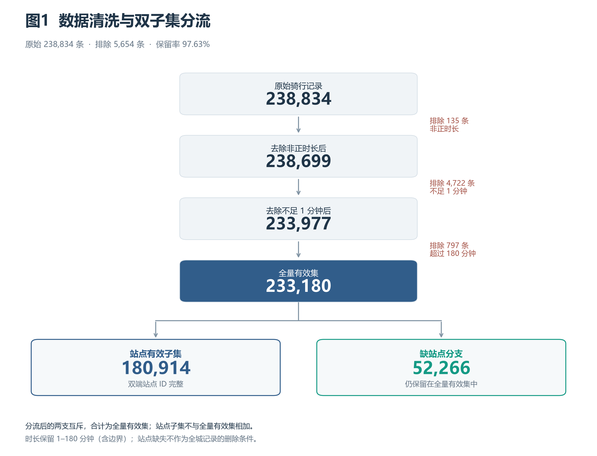
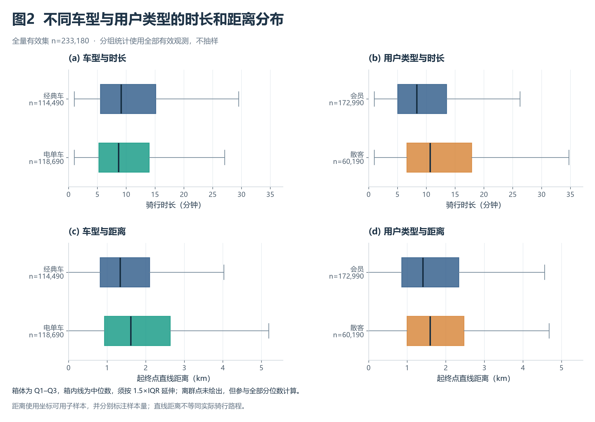
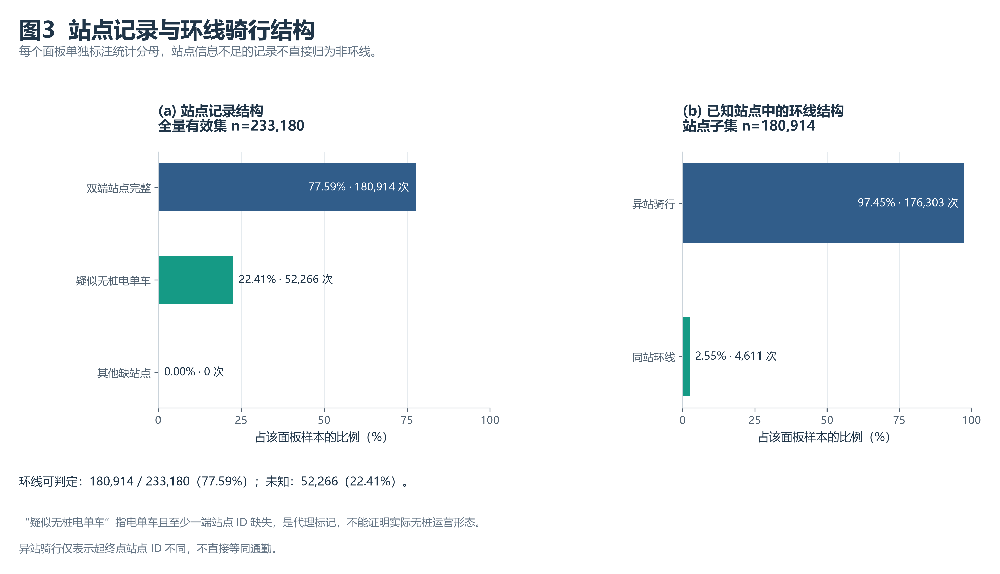

# 城市共享单车出行时空分析与调度优化

**本部分作者：马文博**

本部分包括引言、数据介绍、数据清洗与预处理，以及数据分析章节中的基础探索内容。陈宇涵负责时间规律与需求预测，康炜奕负责空间分布、站点失衡与调度优化；这些模块共同使用下文约定的数据接口。

## 1 引言

### 1.1 研究背景

共享单车订单记录了每次骑行的出发时间、还车时间、起终点位置、车辆类型和用户类型，可以用于描述短途出行的时间分布、空间联系及不同群体的使用特征。将订单按小时、星期和站点聚合，有助于进一步研究需求变化与站点间的流入、流出差异，为车辆投放和调度分析提供依据。

订单数据在分析前需要统一统计口径。例如，站点缺失会影响站点归属，却不一定妨碍按出发时间统计骑行量；起终点坐标只能提供位置间的直线距离，不能还原实际骑行路线。如果不区分这些用途，直接删除所有缺失记录或混用不同样本的分母，就可能改变需求规模与车型结构的描述。

本项目以课程提供的 2024 年 1 月共享单车骑行 CSV 为研究对象，先完成可复核的数据审查、清洗和基础探索，再由各分析模块研究时间规律、空间分布和调度问题。本部分建立统一的数据基础，并给出车型、用户类型及站点记录结构的描述性结果。

### 1.2 研究问题与分析思路

本部分围绕以下问题展开：原始数据存在哪些缺失、重复、时长和站点名称问题；如何同时满足全城骑行统计与站点分析的样本需求；不同车型和用户类型的典型骑行时长、直线距离有何差异；站点信息的完整程度如何影响同站、异站行程的识别。

分析采用“原始数据审查 → 统一规则清洗 → 构造公共特征 → 导出双子集 → 分组统计与图表解释”的流程。所有筛选规则集中保存在配置文件中，Notebook 直接调用项目代码，统计表与图表使用同一批清洗结果，以便复核和衔接后续分析。

## 2 数据介绍

### 2.1 数据来源与观察范围

数据来自课程提供的文件 `题5_共享单车骑行_202401.csv`，原始数据包含 **238,834 条记录、13 个字段**。每条记录对应一次骑行，不对应一名唯一用户，因此订单占比不能解释为人口占比或会员人数占比。本文依据给定文件开展分析，不对文件未说明的运营商、采集流程和覆盖完整性作额外假定。

原始出发时间范围为 **2024-01-01 00:00:15 至 2024-01-31 23:59:51**；还车时间范围为 **2024-01-01 00:04:53 至 2024-02-01 23:35:46**。本项目以出发时间界定分析月份，即保留出发时间位于 2024 年 1 月的记录，并按完整起止时间计算时长。1 月出发、2 月还车的记录不会仅因跨月被排除。

时间按原文件语义解析，不额外进行时区转换。数据只有单月订单，未提供用户唯一标识、实际轨迹、实时车辆库存、站点容量、天气或专门的节假日标签，因此本部分主要进行订单层面的描述性分析。

### 2.2 原始字段与业务含义

| 字段 | 含义与读取约定 |
| --- | --- |
| `ride_id` | 骑行订单标识，按字符串读取，用于检查缺失和重复 |
| `rideable_type` | 车辆类型：`classic_bike` 为经典车，`electric_bike` 为电单车 |
| `started_at` | 出发时间，解析为日期时间，用于月份、小时与星期统计 |
| `ended_at` | 还车时间，解析为日期时间，与出发时间共同计算时长 |
| `start_station_name` | 起点站名称，可缺失 |
| `start_station_id` | 起点站 ID，按字符串读取，避免丢失可能的前导零 |
| `end_station_name` | 终点站名称，可缺失 |
| `end_station_id` | 终点站 ID，按字符串读取，用于确定终点归属 |
| `start_lat`、`start_lng` | 起点纬度、经度，转换为可缺失数值 |
| `end_lat`、`end_lng` | 终点纬度、经度，转换为可缺失数值 |
| `member_casual` | 用户类型：`member` 为会员骑行，`casual` 为散客骑行 |

### 2.3 原始数据质量概况

审查未发现订单号缺失、重复订单号、起止时间解析失败、分析月份外出发、未知车型或未知用户类型。文本规范化后整行重复数也为 0；共有 3,213 条记录含有需要去除的首尾空白。

主要缺失与异常情况如下，百分比均以原始 238,834 条记录为分母。

| 问题 | 记录数 | 占原始数据比例 | 对分析的影响 |
| --- | ---: | ---: | --- |
| 起点站 ID 缺失 | 37,220 | 15.58% | 无法直接归属起点站；起点站名称缺失数相同 |
| 终点站 ID 缺失 | 39,741 | 16.64% | 无法直接归属终点站；终点站名称缺失数相同 |
| 至少一端站点 ID 缺失 | 54,946 | 23.01% | 不能直接纳入完整站点 OD 分析 |
| 至少一个坐标缺失 | 203 | 0.08% | 无法计算起终点直线距离；本次均为终点经纬度缺失 |
| 时长小于或等于 0 分钟 | 135 | 0.06% | 不满足有效正时长要求 |
| 时长大于 0、但不足 1 分钟 | 4,722 | 1.98% | 不满足本项目的最短分析时长 |
| 时长超过 180 分钟 | 797 | 0.33% | 超出本项目的最长分析时长 |

起点、终点缺失集合有重叠，不能将二者的数量相加作为缺站点总数。不同类型的异常也可能重叠：203 条坐标缺失记录均同时属于超过 1,440 分钟的长时记录。实际排除数量以按顺序去重计数的清洗漏斗为准。

## 3 数据清洗与预处理

### 3.1 文本、标识符与字段类型

首先以字符串读取原始字段，去除文本首尾空白，将空字符串统一为缺失值。订单号和站点 ID 始终保留为字符串；分类字段按照配置中的允许值检查。起止时间使用完整日期时间解析，经纬度转换为可缺失数值，避免把缺失坐标填为 0 而引入虚假位置。

对于重复订单，规则规定保留原文件中首次出现的记录，后续出现项排除；本次数据没有触发该规则。审查与清洗均保留原始文件，通过独立导出生成处理后的数据。

### 3.2 时长重算与基础筛选

骑行时长使用起止时间之差的总秒数计算：

```math
T=\frac{\Delta t}{60}
```

其中，Δt 为完整起止时间差的总秒数，T 为骑行时长，单位为分钟，对应字段 `duration_min`。即：**骑行时长（分钟）＝完整起止时间差的总秒数 ÷ 60**。

计算使用完整时间差，不只提取分钟部分，因此能够处理跨日和跨月行程。分析月份采用左闭右开区间：出发时间大于或等于 `2024-01-01 00:00:00`，并小于 `2024-02-01 00:00:00`。

本项目约定保留 **1 ≤ 骑行时长 ≤ 180 分钟**，两端边界均包含。这是短途骑行分析的样本口径，不意味着区间外行程在运营意义上一定无效。超过 1,440 分钟的 228 条记录另作超时标记，它们已包含在超过 180 分钟的 797 条记录中，不重复扣减，也不据此认定丢车。

订单号缺失、重复订单的后续项、无效时间、月份范围外出发、未知车型和未知用户类型按固定顺序检查，本次各项排除数均为 0。随后按时长规则筛选的结果见表。

| 清洗阶段 | 本阶段排除数 | 剩余记录数 |
| --- | ---: | ---: |
| 原始数据 | 0 | 238,834 |
| 基础字段、重复、时间范围和类别检查 | 0 | 238,834 |
| 排除时长小于或等于 0 分钟 | 135 | 238,699 |
| 排除正时长但不足 1 分钟 | 4,722 | 233,977 |
| 排除时长超过 180 分钟 | 797 | 233,180 |

基础清洗合计排除 **5,654 条，占原始记录的 2.37%**；保留 **233,180 条，保留率为 97.63%**。原始数据中有 35 条跨月还车记录，其中 19 条满足全部基础条件，保留在有效集中。

### 3.3 时长阈值的敏感性

为展示最长时长约定对样本量的影响，固定其余条件和 1 分钟下限，仅调整时长上限。统计结果如下。

| 最长时长，含边界（分钟） | 全量有效集记录数 | 双端站点完整记录数 |
| ---: | ---: | ---: |
| 60 | 229,884 | 178,237 |
| 120 | 232,662 | 180,470 |
| 180（当前口径） | 233,180 | 180,914 |
| 240 | 233,363 | 181,054 |
| 1,440 | 233,749 | 181,409 |

例如，将上限从 180 分钟收紧到 120 分钟，会减少 518 条记录，约占当前全量有效集的 0.22%。该比较说明样本量随阈值变化的程度，但不能证明不同阈值下所有分组结论或预测结果都稳定。配置中的参考行数仅用于结果对照，不参与筛选，也不通过截取、补齐或抽样使结果达到目标数量。

### 3.4 站点、名称与坐标处理

站点缺失不作为全城时间分析记录的直接排除条件。基础清洗后，仍有 **52,266 条记录至少缺少一端站点 ID**；保留这些记录可以使时间、车型及用户类型统计覆盖全部满足基础规则的订单。空间分析、站点 OD 和站点需求统计另取双端站点 ID 完整的子集。

站点名称以 ID 为归属依据：合并起终点观测后，选择同一 ID 出现频数最多的名称作为规范名称；频数并列时按名称排序确定。不同 ID 不因名称相同而合并。原始数据包含 761 个已知站点 ID，其中 1 个 ID 对应多个名称，未发现一个名称对应多个 ID 的情况。ID `31380` 的两个名称及频数分别为：

- `Sunrise Valley Dr & Roland Clarke Pl`：10 次，作为规范名称；
- `Roland Clarke Pl & Sunrise Valley Dr`：5 次，统一为规范名称。

本次共统一了 5 条记录中的 5 个起终点名称，完整映射保存在 [station_name_mapping.csv](../tables/station_name_mapping.csv)，没有改写原始数据文件。

坐标需要为有限数值，纬度位于 −90 至 90、经度位于 −180 至 180；缺失、无法转换或超出范围的坐标不参与距离计算。原始数据未发现非数值或范围外坐标。由于本次 203 条坐标缺失记录均已因时长超限被排除，最终全量有效集中的 233,180 条记录均可计算直线距离。这个结果不改变“坐标问题单独标记、不直接删除全城时间记录”的规则，也不代表已验证每个位置的实际精度。

### 3.5 公共特征构造

在保留原始 13 个字段名的基础上，增加以下 8 个字段，导出数据共 21 列。

| 派生字段 | 类型 | 定义与用途 |
| --- | --- | --- |
| `duration_min` | 可缺失浮点数 | 完整起止时间差，单位为分钟；本次有效集均非缺失 |
| `dist_km` | 可缺失浮点数 | 有效坐标计算的 Haversine 球面直线距离，单位为 km |
| `hour` | 整数 | 出发小时，0–23，用于小时聚合 |
| `weekday` | 整数 | 出发星期，周一为 0、周日为 6 |
| `is_weekend` | 布尔值 | `weekday >= 5`，只表示周六、周日，不等同于节假日 |
| `has_station_info` | 布尔值 | 起终点站点 ID 均非空 |
| `is_dockless_ebike` | 布尔值 | 电单车且至少一端站点 ID 缺失的代理标记 |
| `is_loop_trip` | 可缺失布尔值 | 两端站点 ID 已知时判断是否相等；站点不足时为未知 |

直线距离采用球面 Haversine 公式，球半径取 6,371 km。设起终点纬度为 φ₁、φ₂，经度为 λ₁、λ₂，全部转换为弧度，则：

```math
\begin{aligned}
a&=\sin^2\left(\frac{\varphi_2-\varphi_1}{2}\right)+\cos\varphi_1\cos\varphi_2\sin^2\left(\frac{\lambda_2-\lambda_1}{2}\right),\\
d&=2R\operatorname{atan2}(\sqrt{a},\sqrt{1-a}).
\end{aligned}
```

计算时将浮点误差可能造成的 a 值裁剪到 [0, 1]。距离仅表示坐标位置之间的球面直线距离，不能当作实际骑行路程或直接用于推断真实车速。即使起终点坐标相同，距离为 0，也不能据此断定骑行过程没有移动。

`is_dockless_ebike` 的字段名保留项目接口约定，正文统一将其解释为“电单车缺站点的代理标记”。站点缺失可能来自多种原因，仅凭该标记无法确认实际无桩运营形态。`is_loop_trip` 表示起终点 ID 是否相同，不等于拥有实际环形路线；未知值不能直接转换为非环线。

### 3.6 双子集导出与质量校验

清洗后生成两份 UTF-8 BOM 编码的 CSV，均不导出额外索引列。

| 数据文件 | 行数 × 列数 | 适用范围 |
| --- | ---: | --- |
| [clean_trips.csv](../../data/processed/clean_trips.csv) | 233,180 × 21 | 全城时间规律、车型和用户类型的基础分析 |
| [station_trips.csv](../../data/processed/station_trips.csv) | 180,914 × 21 | 完整站点 OD、站点需求及站点流入流出分析 |

站点子集严格包含于全量有效集，占全量有效集的 **77.59%**。其余 **52,266 条，占 22.41%**，仍保留在全量有效集中。二者不能作为相互独立的数据集相加；只有“站点完整分支”与“缺站点分支”互斥，二者合计为全量有效集。



**图1说明：**图中逐步列出实际触发排除的规则及剩余数量。双子集设计分别满足全城统计与站点归属的需要，避免因站点缺失而直接丢失可用于时间分析的订单。

导出过程校验订单号非空且唯一、字段顺序一致、时长和出发月份满足规则、已知距离非负且有限，并检查站点子集与全量有效集中的对应行完全一致。CSV 本身不保存字段类型，读取时使用 [read_clean_data()](../../src/data_cleaning.py) 恢复字符串 ID、日期时间、数值与可缺失布尔值，避免丢失前导零或错误转换字符串 `"False"`。

## 4 数据分析与建模及可视化：基础探索部分

### 4.1 样本构成与统计口径

基础探索以全量有效集的 233,180 次骑行为样本。以下两种维度分别划分同一批订单，每种维度内部的占比合计为 100%；不同维度的行不能再次合计。

| 分组维度 | 类别 | 骑行次数 | 占全量有效集比例 |
| --- | --- | ---: | ---: |
| 车型 | 经典车 | 114,490 | 49.10% |
| 车型 | 电单车 | 118,690 | 50.90% |
| 用户类型 | 会员 | 172,990 | 74.19% |
| 用户类型 | 散客 | 60,190 | 25.81% |

本月有效订单中，电单车与经典车的次数较接近，电单车略多；会员订单占比约为四分之三。这些比例描述已记录、且通过清洗的骑行次数。没有用户唯一标识、可用车辆数和暴露时间，不能据此计算用户活跃率、每车使用率或人均骑行频次。

### 4.2 不同车型和用户类型的骑行时长

分组统计同时报告均值、中位数、四分位区间和第 95 百分位数（P95），避免只依赖易受长尾影响的均值。表中数值保留两位小数，单位为分钟；分组样本量与 4.1 节一致。

| 分组 | 均值 | 中位数 | Q1–Q3 | P95 |
| --- | ---: | ---: | ---: | ---: |
| 经典车 | 13.15 | 9.13 | 5.52–15.12 | 36.25 |
| 电单车 | 11.74 | 8.67 | 5.23–13.98 | 30.78 |
| 会员 | 11.08 | 8.35 | 5.03–13.53 | 28.42 |
| 散客 | 16.32 | 10.67 | 6.63–17.88 | 49.62 |

电单车的时长中位数为 8.67 分钟，略低于经典车的 9.13 分钟；散客的时长中位数为 10.67 分钟，高于会员的 8.35 分钟。散客的 P95 为 49.62 分钟，也高于会员的 28.42 分钟，说明在当前样本与清洗口径下，散客组的高分位时长更大。

各组均值均高于中位数，结合四分位区间和高分位数，可以看到时长分布存在右侧长尾。这里的分组差异属于描述性比较，尚未控制起终点、出发时段等条件，也未进行显著性检验，不能直接解释为车型或会员身份造成了时长变化。

### 4.3 起终点直线距离的分布

本次全量有效集没有距离缺失，因此距离与时长使用相同的分组样本量。距离统计单位为 km，表中数值保留两位小数。

| 分组 | 均值 | 中位数 | Q1–Q3 | P95 |
| --- | ---: | ---: | ---: | ---: |
| 经典车 | 1.61 | 1.34 | 0.82–2.10 | 3.87 |
| 电单车 | 1.98 | 1.61 | 0.93–2.64 | 4.85 |
| 会员 | 1.76 | 1.41 | 0.86–2.34 | 4.38 |
| 散客 | 1.92 | 1.59 | 1.00–2.47 | 4.54 |

电单车的直线距离中位数为 1.61 km，高于经典车的 1.34 km，同时其时长中位数略低。该现象说明两类订单的位置间距和时长分布有所不同；由于没有实际路线，也没有控制地形、交通和用户选择等因素，不能用这些分组中位数的比值推算真实骑行速度或车型的因果效果。

散客的直线距离中位数为 1.59 km，略高于会员的 1.41 km。四个分组的距离均值均高于中位数，且 P95 明显高于 Q3，表明直线距离也存在右侧长尾。基础描述支持从车型和用户类型继续分组研究，但不替代后续需求模型的评估。



**图2说明：**上排比较时长，下排比较直线距离；箱体表示 Q1–Q3，箱内线表示中位数，须按 1.5 倍四分位距规则延伸到范围内的实际观测值。图中不绘制离群点以便观察主体分布，全部有效观测仍参与统计，未再次按箱线图规则删除记录。横轴范围展示箱体与须，完整样本的极值和 P95 可在统计表中复核。

### 4.4 站点完整性与同站行程结构

站点记录结构以全量有效集为分母；同站、异站行程则只在双端站点 ID 已知的记录中比较。两种统计分母如下。

| 统计范围 | 类别 | 记录数 | 分母 | 比例 |
| --- | --- | ---: | ---: | ---: |
| 全量有效集的站点结构 | 双端站点完整 | 180,914 | 233,180 | 77.59% |
| 全量有效集的站点结构 | 电单车且至少一端缺站点 | 52,266 | 233,180 | 22.41% |
| 全量有效集的站点结构 | 其他缺站点 | 0 | 233,180 | 0.00% |
| 站点子集的起终点关系 | 起终点站点 ID 不同 | 176,303 | 180,914 | 97.45% |
| 站点子集的起终点关系 | 起终点站点 ID 相同 | 4,611 | 180,914 | 2.55% |

清洗后缺站点的 52,266 条记录全部来自电单车，对应接口中的“疑似无桩电单车”代理标记。原始数据中虽有 222 条经典车缺站点记录，但它们均因其他基础条件被排除，因此不能将“缺站点均为电单车”推广到原始数据或其他月份。图中的代理类别也不能当作真实无桩车辆数量。

站点子集中，同站行程为 4,611 次，占可判定记录的 2.55%；异站行程为 176,303 次，占 97.45%。全量有效集中另有 52,266 次、即 22.41% 的行程无法依据站点 ID 判断是否同站，保留为未知，不能归入非环线后再计算全量占比。



**图3说明：**左图分母为全量有效集，右图分母为站点子集。这里“同站环线”仅表示起终点 ID 相同；异站骑行也只表示站点不同，不能仅凭这一条件判断通勤目的。由于缺站点的有效记录集中在电单车中，站点子集与全量有效集的覆盖结构不同，站点子集的结论应注明适用范围。

### 4.5 基础探索的结论与解释边界

在当前月份及 1–180 分钟的统一口径下，数据清洗保留了 97.63% 的原始订单。电单车订单的直线距离中位数较高、时长中位数略低；散客订单的时长和直线距离中位数均高于会员。已知站点行程以异站骑行为主，同时全量有效集中有 22.41% 的行程不能依靠站点 ID 识别起终点关系。以上发现为进一步研究时段、车型、用户类型及站点需求提供了分组依据。

这些结果适用于本月记录及既定筛选条件。时长截断会改变尾部结构，单月数据不足以刻画全年或季节差异；周末标记没有单独识别节假日；坐标距离不能替代实际路程；站点缺失限制了全量订单的站点归属。由于缺少实时库存与站点容量，订单流入流出只能提供失衡分析的观测依据，不能直接确认实际缺车、满桩或未满足的需求。

陈宇涵可使用全量有效集开展全城时间分析，进行站点级预测时使用站点子集并注明覆盖范围；康炜奕可使用站点子集研究 OD 与站点流入流出，研究缺站点电单车的位置分布时从全量有效集提取相应记录并检查坐标。各模块需要延续相同的出发时间、清洗阈值、字段含义和统计分母，避免混用样本。

## 复核资料

本部分的图表均为已有的 300 DPI PNG。正文数值与下列配置、统计表和 Notebook 对应，表中小数仅作展示性舍入。

- [清洗规则配置](../../config/cleaning_rules.json)：月份范围、时长边界、类别及参考行数。
- [数据质量报告](../tables/data_quality_summary.md)：原始数据校验值、缺失与异常审查、清洗漏斗和站点名称处理。
- [时长阈值敏感性](../tables/duration_threshold_sensitivity.csv)：不同上限下的两份子集行数。
- [分组描述统计](../tables/basic_eda_summary.csv)：样本量、缺失数、均值、分位数及极值。
- [结构占比统计](../tables/trip_structure_summary.csv)：站点完整性、环线可判定性及各项分母。
- [完整分析 Notebook](../../notebooks/01_cleaning_and_eda.ipynb)：从原始数据到双子集、三张图及接口检查的复现过程。
- [项目代码仓库](https://github.com/hhkQWQ/Pyclass)：数据处理、公共绘图与模块协作的版本记录。

在项目根目录可依次运行 `python -m src.data_audit`、`python -m src.data_cleaning` 和 `python -m src.basic_eda` 重新生成数据与图表；也可在项目环境的 Jupyter 中打开 Notebook，选择 `Python (Pyclass)` 内核后重启并运行全部单元格。依赖与环境配置见 [README](../../README.md)。Notebook 已在独立新内核中完整执行通过；项目现有的 15 项数据审查与清洗测试已通过，涵盖时长边界、异常重叠计数、距离计算和 CSV 类型恢复等关键规则。
