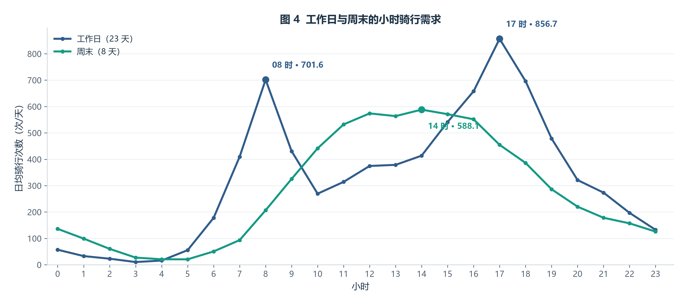
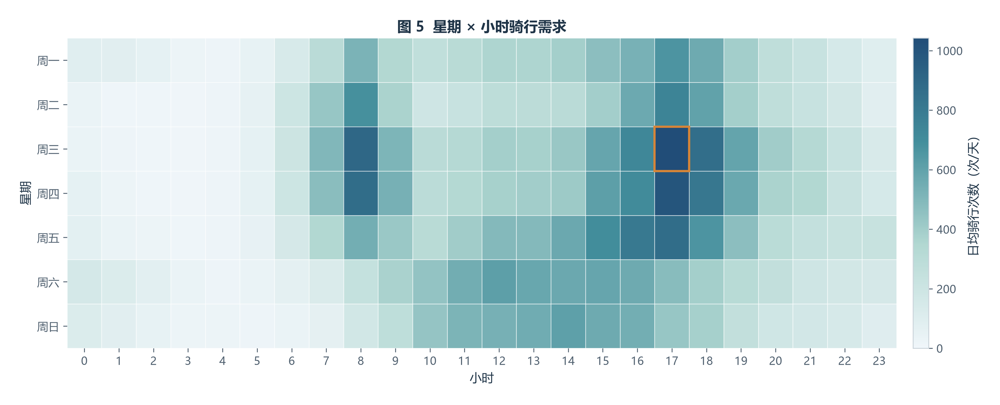

# 共享单车时间规律分析

**本部分作者：陈宇涵**

本部分包含已完成的时间规律分析与图4、图5；需求预测及模型评估仍待补充。

## 5 时间规律分析

### 5.1 数据与分析范围

本部分研究一天和一周内的骑行需求变化。输入为 `data/processed/clean_trips.csv`：**233,180 行、21 列**，一行代表一次骑行。开始时间从 2024-01-01 00:00:15 到 2024-01-31 23:59:51，覆盖 2024 年 1 月的 31 天。

| 字段分组 | 字段 | 简单说明 |
|---|---|---|
| 骑行标识 | `ride_id` | 文本，每次骑行的唯一编号 |
| 车辆与用户 | `rideable_type`、`member_casual` | 文本，车辆类型和会员/临时用户类型 |
| 起止时间 | `started_at`、`ended_at` | 日期时间，何时出发和结束 |
| 站点 | `start_station_name`、`start_station_id`、`end_station_name`、`end_station_id` | 文本，起终点站名和编号；编号保留为文本 |
| 坐标 | `start_lat`、`start_lng`、`end_lat`、`end_lng` | 数值，起终点经纬度，部分可缺失 |
| 时长与距离 | `duration_min`、`dist_km` | 数值，分钟和起终点直线距离（公里），距离不是实际骑行路线长度 |
| 时间特征 | `hour`、`weekday`、`is_weekend` | 小时 0–23、星期 0–6（周一=0）、是否周末 |
| 其他标记 | `has_station_info`、`is_dockless_ebike`、`is_loop_trip` | 是否具备起终点站 ID、缺站点电单车代理标记、是否同站往返 |

**数据选择与检查**：分析对象是全城有效骑行，统计使用订单和出发时间字段。保留站点 ID 不完整但时间有效的 52,266 次骑行（占 22.4%），避免因无关字段缺失而低估需求。读入后核对字段类型、关键字段缺失、订单唯一性和日期范围；站点、坐标等字段不参与本步需求计数，也不统一填零。订单次数不代表独立用户人数。

### 5.2 统计方法与分母

采用描述性统计与分组对比，依次回答“工作日和周末有什么差异”“一周哪些时段更繁忙”。用日期时间列的批量运算提取时间信息，`groupby` 分组汇总，`reindex` 对齐完整日历，计算过程可重复、可核对。

- **按出发时间计数**：一次骑行计入 `started_at` 所在小时，衡量出发需求；沿用数据时间，不转换时区。
- **按星期分类**：周一至周五为工作日，周六、周日为周末；未额外处理当地公共假日。
- **区分零记录与缺数据**：核对 31 天都有记录后，构建 31 × 24 = 744 个小时格；按订单计数口径，无记录的小时记 0，并纳入均值分母。若整天无记录，先停止检查数据完整性，避免直接把缺数据当作零需求。
- **比较日均量**：工作日 23 天、周末 8 天，不能直接用总量比较。日均每小时次数 = 该类日期该小时的总次数 ÷ 该类日期天数。
- **星期分别计算**：周一至周三各 5 天，周四至周日各 4 天；热力图每格也除以对应星期的天数。

### 5.3 可视化方法

**图 4 用折线图**：小时有先后顺序，折线便于对比日内变化和两类日期的差异。横轴为 0–23 时，纵轴为日均骑行次数，两组使用相同单位和坐标。直接绘制分组均值，保留实际峰值；标注工作日主要峰值及周末最高小时。



**图 5 用热力图**：同时查看星期与小时两个维度，比逐条比较曲线更容易定位繁忙时段。行是星期、列是小时，每格为日均需求次数；色标从 0 起，颜色越深需求越高，橙框标记最高格。两张图都配有明确单位和可核对的读数。



### 5.4 实际结果与限制

- 工作日主要峰值为 08 时（701.6 次/天）、17 时（856.7 次/天）；周末最高小时为 14:00–15:00，日均 588.1 次。
- 工作日日均总量 7,818.3 次，周末 6,669.9 次；周末约为工作日的 85.3%。
- 星期与小时组合中，周三 17:00–18:00 最强，日均 1,042.6 次。

这些结果为后续需求预测和调度讨论提供重点观察时段。分组差异只能说明分布不同，通勤、天气或假日等原因仍需其他资料验证。结果仅代表 2024 年 1 月，日均值也会掩盖日期间的波动；每天有记录并不能完全排除局部漏采。

### 5.5 复现与核对

在项目根目录使用统一虚拟环境运行：

```powershell
.\.venv\Scripts\python.exe -m src.temporal_analysis
```

直接运行 `python src/temporal_analysis.py` 也可；依赖与环境配置见 [README](../../README.md)。脚本将统计、核验、绘图和导出分为独立函数，图与表共用一份统计结果。输出包括离线 HTML、图 4/5 和两份汇总 CSV；其中 `total_rides` 是总次数，`days` 是天数，`daily_mean_rides` 是日均值（保留四位小数）。

本次 **15 项统计核验全部通过**：关键字段、日期覆盖、小时补齐、分组分母及总次数均一致。实际值与预期值保存在 [统计核验表](../tables/temporal_validation_summary.csv)，HTML 也可展开查看和下载。两张汇总表的总次数均为 233,180；核对依据是实际输入行数，不以固定参考行数作为筛选目标。

方法对应教材中的向量化、分组聚合、索引对齐、函数复用与按问题选图；核验用于检查本步统计结果的可靠性。

输入版本：[项目数据版本](https://github.com/hhkQWQ/Pyclass/tree/777c65867a129d6f0dba03c0acfefbbce1e98cae)；本地基线提交：`b32ce1dbf8932499fd9967197bace83ee4afaa42`。输入文件：`clean_trips.csv`；SHA-256：`1ea4c2d6ccc091e73f3633ec2f58b551fc9c3d1aec5e58f235995c426879d7c0`。
