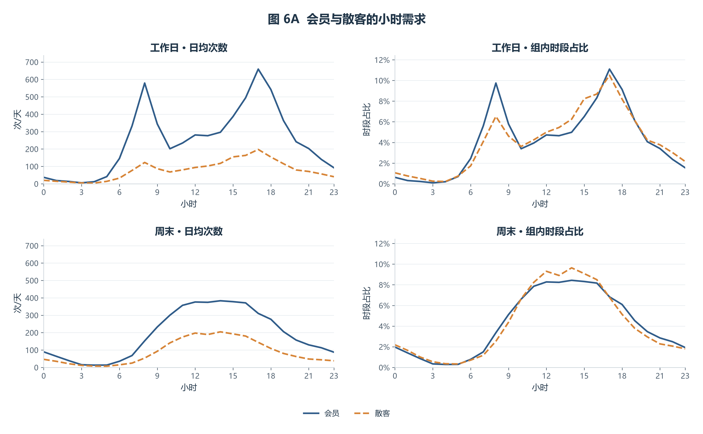
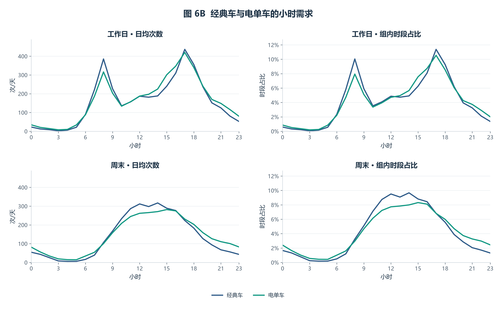
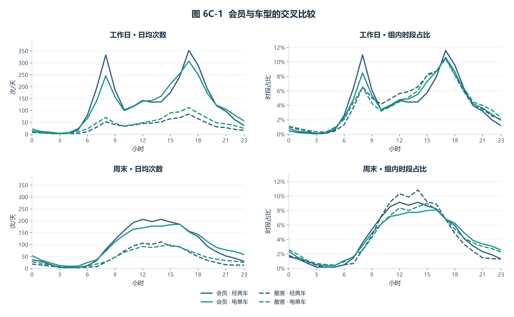
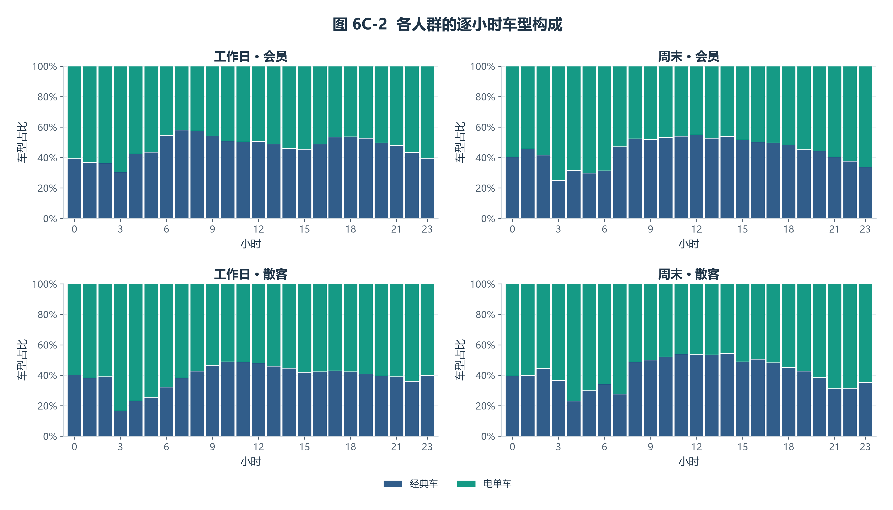

# 成员 B：时间规律与会员、车型差异（任务 1、2）

## 1. 数据是什么

本部分研究一天和一周内的骑行需求变化。输入为 `data/processed/clean_trips.csv`：**233,180 行、21 列**，一行代表一次骑行。开始时间从 2024-01-01 00:00:15 到 2024-01-31 23:59:51，覆盖 2024 年 1 月的 31 天。

| 字段分组 | 字段 | 简单说明 |
|---|---|---|
| 骑行标识 | `ride_id` | 文本，每次骑行的唯一编号 |
| 车辆与用户 | `rideable_type`、`member_casual` | 文本，车辆类型和会员/临时用户类型 |
| 起止时间 | `started_at`、`ended_at` | 日期时间，何时出发和结束 |
| 站点 | `start_station_name`、`start_station_id`、`end_station_name`、`end_station_id` | 文本，起终点站名和编号；编号保留为文本 |
| 坐标 | `start_lat`、`start_lng`、`end_lat`、`end_lng` | 数值，起终点经纬度，部分可缺失 |
| 时长与距离 | `duration_min`、`dist_km` | 数值，分钟和起终点直线距离（公里），距离不是实际骑行路线长度 |
| 时间特征 | `hour`、`weekday`、`is_weekend` | 小时 0–23、星期 0–6（周一=0）、是否周末 |
| 其他标记 | `has_station_info`、`is_dockless_ebike`、`is_loop_trip` | 是否具备起终点站 ID、缺站点电单车代理标记、是否同站往返 |

**数据选择与检查**：分析对象是全城有效骑行，统计使用订单和出发时间字段。保留站点 ID 不完整但时间有效的 52,266 次骑行（占 22.4%），避免因无关字段缺失而低估需求。读入后核对字段类型、关键字段缺失、订单唯一性和日期范围；站点、坐标等字段不参与本步需求计数，也不统一填零。订单次数不代表独立用户人数。

## 2. 怎么统计，为什么这样做

采用描述性统计与分组对比，依次回答“工作日和周末有什么差异”“一周哪些时段更繁忙”。用日期时间列的批量运算提取时间信息，`groupby` 分组汇总，`reindex` 对齐完整日历，计算过程可重复、可核对。

- **按出发时间计数**：一次骑行计入 `started_at` 所在小时，衡量出发需求；沿用数据时间，不转换时区。
- **按星期分类**：周一至周五为工作日，周六、周日为周末；未额外处理当地公共假日。
- **区分零记录与缺数据**：核对 31 天都有记录后，构建 31 × 24 = 744 个小时格；按订单计数口径，无记录的小时记 0，并纳入均值分母。若整天无记录，先停止检查数据完整性，避免直接把缺数据当作零需求。
- **比较日均量**：工作日 23 天、周末 8 天，不能直接用总量比较。日均每小时次数 = 该类日期该小时的总次数 ÷ 该类日期天数。
- **星期分别计算**：周一至周三各 5 天，周四至周日各 4 天；热力图每格也除以对应星期的天数。

## 3. 为什么选这两种图

**图 4 用折线图**：小时有先后顺序，折线便于对比日内变化和两类日期的差异。横轴为 0–23 时，纵轴为日均骑行次数，两组使用相同单位和坐标。直接绘制分组均值，保留实际峰值；标注工作日主要峰值及周末最高小时。


**图 5 用热力图**：同时查看星期与小时两个维度，比逐条比较曲线更容易定位繁忙时段。行是星期、列是小时，每格为日均需求次数；色标从 0 起，颜色越深需求越高，橙框标记最高格。两张图都配有明确单位和可核对的读数。


## 4. 实际结果与限制

- 工作日主要峰值为 08 时（701.6 次/天）、17 时（856.7 次/天）；周末最高小时为 14:00–15:00，日均 588.1 次。
- 工作日日均总量 7,818.3 次，周末 6,669.9 次；周末约为工作日的 85.3%。
- 星期与小时组合中，周三 17:00–18:00 最强，日均 1,042.6 次。

这些结果为后续需求预测和调度讨论提供重点观察时段。分组差异只能说明分布不同，通勤、天气或假日等原因仍需其他资料验证。结果仅代表 2024 年 1 月，日均值也会掩盖日期间的波动；每天有记录并不能完全排除局部漏采。

## 5. 会员与车型的时段差异（任务 2）

使用 `member_casual`（member=会员、casual=散客）与 `rideable_type`（classic_bike=经典车、electric_bike=电单车）。两个字段均通过缺失与类别核对；沿用全量有效骑行，分别分析工作日和周末。

### 统计方法与三个分母

先用批量日期运算与 `groupby` 计数，再用完整索引 `reindex` 对齐日期×小时×会员×车型。31×24×2×2=2,976 个组合全部保留，零记录组合计为 0。日均分母来自完整日历，而不是某组有骑行的日期数。

- **日均每小时次数**＝该组该小时总次数÷对应日期类型的天数，比较需求规模。
- **组内时段占比**＝该组该小时总次数÷该组在对应日期类型内的全天总次数，比较一天中的分布；各组 24 小时合计为 100%。
- **该小时车型占比**＝该人群该小时某车型次数÷该人群该小时两种车型总次数，比较车型构成；每个人群、每个小时的两车型合计为 100%。
- 分母为零时保留缺失值，HTML 显示“无数据”，图中留空；不把无法计算的比例填成 0。

会员与散客总量不同，日均次数和组内时段占比需要配合阅读。整体车型占比用总次数之比计算，避免低需求小时与高需求小时被赋予相同权重。

### 图 6A：会员与散客

折线保留小时顺序，左右分开展示次数与占比；上下分别为工作日和周末，使用相同的纵轴范围。



- 工作日：会员、散客日均分别为 5,940.0、1,878.3 次，最高小时分别为 17 时、17 时。
- 周末：会员、散客日均分别为 4,546.1、2,123.8 次，最高小时分别为 14 时、14 时。

工作日差异最大在 08 时，会员与散客的时段占比分别为 9.7%、6.5%（相差 3.2 个百分点）；周末差异最大在 14 时，会员与散客的时段占比分别为 8.4%、9.6%（相差 1.2 个百分点）。

### 图 6B：经典车与电单车

沿用相同布局，观察需求规模与归一化曲线是否给出不同的信息。



- 工作日：经典车、电单车日均分别为 3,837.1、3,981.2 次，最高小时分别为 17 时、17 时。
- 周末：经典车、电单车日均分别为 3,279.5、3,390.4 次，最高小时分别为 14 时、15 时。

工作日差异最大在 08 时，经典车与电单车的时段占比分别为 10.0%、7.9%（相差 2.1 个百分点）；周末差异最大在 12 时，经典车与电单车的时段占比分别为 9.5%、7.7%（相差 1.8 个百分点）。

### 图 6C-1：四种组合

交叉分组检查总体差异；颜色区分车型，线型区分会员与散客，减少同时辨认四种颜色的负担。



- 工作日：四种组合中，会员 · 经典车的日均总量最高，为 3,040.0 次；最高小时为 17 时。
- 周末：四种组合中，会员 · 电单车的日均总量最高，为 2,292.0 次；最高小时为 16 时。

### 图 6C-2：人群内部的车型构成

百分比堆叠柱展示每小时的整体与部分关系；按人群、日期类型拆成四个子图。



- 工作日：会员、散客骑行中的电单车占比分别为 48.8%、57.6%，散客比会员高 8.7 个百分点。
- 周末：会员、散客骑行中的电单车占比分别为 50.4%、51.7%，散客比会员高 1.3 个百分点。

### 导出与结果核验

逐小时 CSV 保留 `total_rides`、`days`、`daily_mean_rides`、`group_total_rides`、`time_share`；车型构成表保留 `member_hour_total`、`vehicle_share`。比例保存为 0–1 小数，展示时转换成百分比。`fig06_preference_summary.csv` 给出各组日均总量、最高小时、最高小时次数与占比；并列最高小时全部保留。

核验原始骑行与补齐计数逐格一致、四组合边际可还原会员/车型/任务1汇总、日历分母正确、占比合计正确。图、表和文字共用同一份统计结果。

这些差异描述本月骑行记录的使用分布。记录不含用户唯一标识，无法计算独立用户人数；日均曲线也会掩盖不同日期间的波动。


## 6. 如何复现与核对

在 `D:/Pyclass/terminal/temporal_modeling` 目录、已有的 Pyclass 环境中运行：

```powershell
Set-Location 'D:/Pyclass/terminal/temporal_modeling'
conda run -n Pyclass python -m src.temporal_analysis
```

直接运行 `python src/temporal_analysis.py` 也可；确保使用 Pyclass 的 Python。脚本将统计、核验、绘图和导出分为独立函数，图与表共用一份统计结果。输出包括离线 HTML、图 4/5、图 6A/6B/6C-1/6C-2，以及对应 CSV。图 4/5 的数值保留四位小数，图 6 的数值保留八位小数；百分比在 CSV 中保存为 0–1 小数。

本次 **46 项统计核验全部通过**：关键字段、日期覆盖、小时补齐、分组分母及总次数均一致。实际值与预期值保存在 [统计核验表](../tables/temporal_validation_summary.csv)，HTML 也可展开查看和下载。两张汇总表的总次数均为 233,180；核对依据是实际输入行数，不以固定参考行数作为筛选目标。

方法对应教材中的向量化、分组聚合、索引对齐、函数复用与按问题选图；核验用于检查本步统计结果的可靠性。

输入版本：[项目数据版本](https://github.com/hhkQWQ/Pyclass/tree/777c65867a129d6f0dba03c0acfefbbce1e98cae)；本地基线提交：`94622f080d8b6dadf7715eccfa9dae3a5e0fec24`。输入文件：`clean_trips.csv`；SHA-256：`1ea4c2d6ccc091e73f3633ec2f58b551fc9c3d1aec5e58f235995c426879d7c0`。
