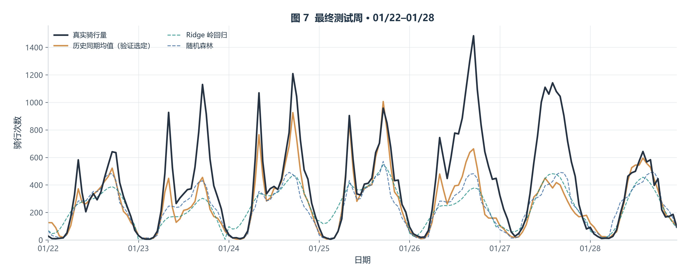
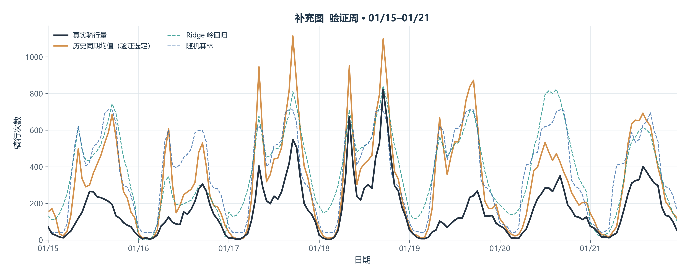
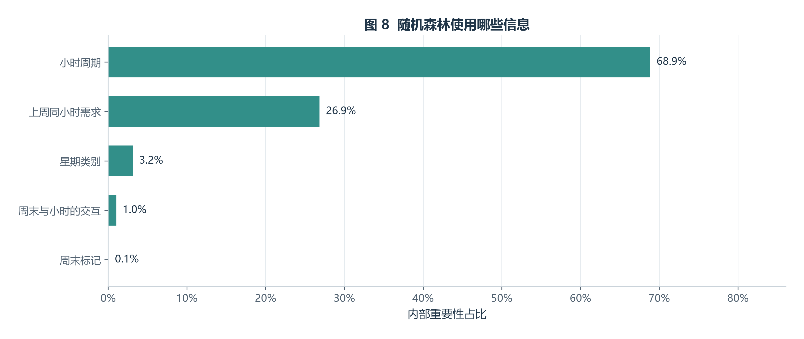

# 全城小时需求预测：周初一次预测未来一周

## 本步骤回答什么

在每周一 00:00，用此前已知的订单信息，一次预测接下来周一至周日的 168 个小时。周内不使用新发生的真实需求更新输入。本步骤只完成全城预测；核心站点筛选与预测在验收后另行开展。不生成跨月预测示例。

## 数据与样本

输入为本项目 `data/processed/clean_trips.csv`：233,180 条有效骑行、21 个字段。每行是一次骑行，以 `started_at` 所在小时计数；保留站点信息不完整但时间有效的记录。先检查订单唯一、月份与时间派生字段一致、31 天均有记录，再补齐 744 个小时；确认完整日期内无订单的小时计为 0。小时计数之和必须等于输入订单数。

23 万条订单只形成 744 个时间样本，不能当作 23 万个独立预测样本。1 月 29–31 日只保留在输入覆盖记录中，不参与选型或评估。月份和范围是数据自身的历史日期，不是对当前日期的实时预测。

| 阶段 | 可用历史 | 一次预测的目标周 | 学习模型可拟合行数 |
|---|---|---|---:|
| 验证 | 1 月 1–14 日，336 小时 | 1 月 15–21 日，168 小时 | 168 |
| 最终测试 | 1 月 1–21 日，504 小时 | 1 月 22–28 日，168 小时 | 336 |

学习模型需要上周同期值，所以删除最初 168 个缺少周滞后的训练行，不用未来数据填补。两种简单对照可使用截止前全部历史。各方法使用相同预测起点和目标时段，但有效拟合行数不同，CSV 会记录差异。

## 特征与预测边界

- 小时：24 小时、12 小时的正余弦周期项，允许表达日内多峰变化。
- 星期：周二至周日的类别指示，周一为参照；另含周末标记。
- 周末与四个小时周期项的交互，允许周末具有不同的小时曲线。
- `lag_168h`：上周同一小时的实际需求。

共 16 个特征；Ridge 与随机森林使用相同特征。周末标记与星期类别存在确定关系，Ridge 通过系数约束处理冗余；系数只用于说明模型，不解释为独立的因果效应。预测周最后一个小时的滞后来源，最多到预测起点前一小时。整周输入可以在周初构造，不用短滞后递推，也不读取目标周实际需求。导出的逐小时预测保留 `forecast_origin`、`lag_source_time` 与 `lag_168h`，便于审查。

## 四种预测与拟合方法

### 1. 历史同期均值

对训练期相同“星期 × 小时”的次数求算术平均。例如周二 8 时的预测，等于历史周二 8 时次数的均值；验证阶段平均 2 个值，测试阶段平均 3 个值。无需迭代拟合，优点是透明、便于复核；局限是平滑变化较大时可能滞后。

### 2. 上周同期

`预测值(t) = 实际值(t − 168 小时)`。无需参数拟合，能直接检验重复最近一周的表现；局限是容易延续上周的异常波动。

### 3. Ridge 岭回归

用 `截距 + 各特征与其系数乘积之和` 拟合需求，优化“平方误差之和 + α × 系数平方和”。后一项约束系数过大。所有特征的标准化只在训练行上拟合，预测周沿用这些训练均值和标准差。比较 α = 0.1、1、10、100，按验证 MAE 选择。优点是可解释、复杂度可控制；局限是预测能力取决于选定特征，且少量周样本无法充分验证稳定性。

### 4. 随机森林

对训练样本进行自助抽样，建立多棵决策树；每棵树通过特征阈值逐步划分样本，叶节点估计需求，再取 200 棵树的平均。比较最大深度 3/5、叶节点最少样本数 8/16 的四种组合；固定随机种子 42。优点是可学习非线性关系；局限是少量周样本仍可能过拟合，对突发变化和范围外需求缺乏可靠外推能力。

预测骑行次数若为负，统一截为 0；评估保留小数，不提前取整。原始预测值和截断次数均保留，便于检查。

## 选型与评估

先在验证周为每种方法选择参数，再以验证 MAE 最低的方法作为推荐；若并列，先比较 RMSE，再按预定方法/参数顺序取值。参数及推荐方法在最终测试前冻结。测试只评估，不据此重新调参、改特征或改推荐方法。

- MAE：平均每小时差多少次，作为主要指标，越小越好。
- RMSE：对大误差更敏感，作为辅助指标，越小越好。
- R²：相对目标周均值的误差参照；可能为负，不将其解释为准确率。目标完全不变时记为无定义。
- 高峰 MAE：分别按训练期工作日/周末日均次数选出最高两个小时，评价目标周这些小时的误差；不根据目标周挑高峰。
- 日、周总量偏差：预测总量减真实总量；同时给出绝对百分比误差。总量接近不能证明每小时都准确。

| 阶段 | 方法 | MAE | RMSE | R² | 高峰 MAE |
|---|---|---:|---:|---:|---:|
| 验证周 | 历史同期均值 | 156.62 | 215.45 | -1.223 | 395.46 |
| 验证周 | 上周同期 | 199.65 | 283.70 | -2.854 | 519.14 |
| 验证周 | Ridge 岭回归 | 209.43 | 250.33 | -2.000 | 309.92 |
| 验证周 | 随机森林 | 205.19 | 253.87 | -2.086 | 315.53 |
| 最终测试周 | 历史同期均值 | 144.15 | 234.92 | 0.510 | 330.64 |
| 最终测试周 | 上周同期 | 237.67 | 346.75 | -0.068 | 577.29 |
| 最终测试周 | Ridge 岭回归 | 192.49 | 291.89 | 0.243 | 543.96 |
| 最终测试周 | 随机森林 | 176.66 | 276.38 | 0.321 | 509.04 |

验证选定：**历史同期均值**。其最终测试 MAE 为 **144.15 次/小时**，RMSE 为 **234.92**。相对历史同期均值的 MAE 改善为 **0.0%**，相对上周同期为 **39.3%**；负值表示更差，基线 MAE 为 0 时相对改善无定义。

**验证周选中了简单对照方法；本次没有预先选出优于它的学习模型。** 不用最终测试的排名回头替换推荐方案。

误差解读：验证周实际总量为 27,778 次，选定方法预测 54,072 次；测试周实际 67,307 次，预测 45,307 次，总量偏差为 **-32.7%**。这说明日内曲线与整周规模需要分开判断，当前方法未充分捕捉周与周之间的规模变化，不能仅因对照排名较好就称为高精度预测。

选定参数：

```json
{
  "historical_mean": {},
  "last_week": {},
  "ridge": {
    "alpha": 100.0
  },
  "random_forest": {
    "n_estimators": 200,
    "max_depth": 5,
    "min_samples_leaf": 16,
    "random_state": 42,
    "n_jobs": 1
  }
}
```

## 图表、有效性与限制



图 7 只呈现最终测试周，保留真实值、历史同期均值、Ridge、随机森林四条曲线。用折线观察日内形状、峰值和偏差；指标表用于精确比较，不能仅凭曲线接近认定有效。上周同期仍保留在完整评估中，不在图表和 HTML 结果表中展示。



验证周单独绘图，在 HTML 中可展开查看。HTML 先介绍 Ridge、随机森林及 MAE、RMSE、R²，再展示结果；数据复核和复现说明保留在工程文件中。



图 8 将随机森林的内部重要性按信息类型合并，解释这一个模型如何使用特征。相关特征可能分摊权重；它不是因果分析，也不是预测有效性的证明，即使随机森林未被选中仍明确标注模型名称。

有效性证据限于一次验证周和一次最终测试周。周总量有明显变化，当前没有天气、节假日、活动或库存等解释变量，不能确定变化原因，也不能保证未来周稳定表现。模型预测的是已观测有效订单量，不是全部潜在需求或未满足需求。

## 复现与产物

在项目目录运行：

```powershell
conda run -n Pyclass python -m src.demand_model
python -B -m unittest discover -s tests -p test_demand_model.py
```

默认独立生成 `reports/demand_prediction.html`，不调用前两项入口。对应表格位于 `reports/tables/city_*.csv`，参数和来源位于 `city_model_selection.json`。CSV 保留 10 位小数，HTML 为阅读而适当四舍五入。统计核验表与单元测试共同检查时间边界、计数和信息泄漏；运行命令会更新本步骤同名产物。

输入 SHA-256：`1ea4c2d6ccc091e73f3633ec2f58b551fc9c3d1aec5e58f235995c426879d7c0`。代码 SHA-256：`4b2f3dc26a9c0fcd2d408c8f70984b3b6447be752845caa85d047e5729897823`。环境：Python 3.13.5、NumPy 2.5.2、pandas 3.0.5、scikit-learn 1.9.1。

方法参考：[简单预测与季节朴素法](https://otexts.com/fpp3/toolbox.html)、[Ridge](https://scikit-learn.org/stable/modules/generated/sklearn.linear_model.Ridge.html)、[随机森林](https://scikit-learn.org/stable/modules/generated/sklearn.ensemble.RandomForestRegressor.html)、[周期时间特征](https://scikit-learn.org/stable/auto_examples/applications/plot_cyclical_feature_engineering.html)。参考方法说明不构成本数据上的有效性结论。
