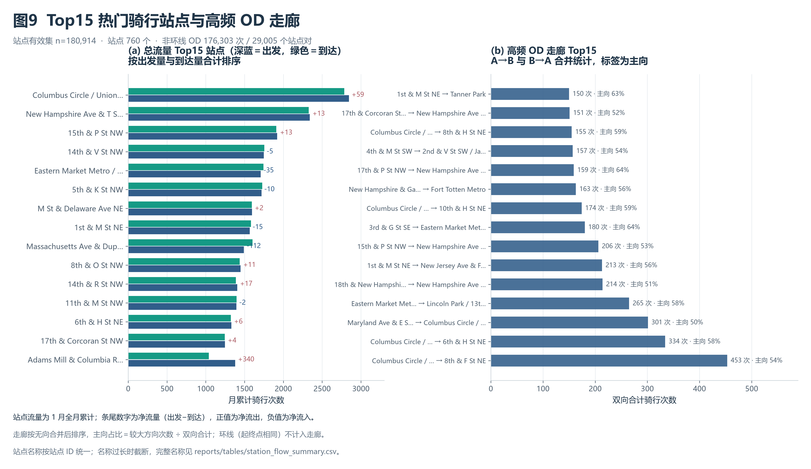
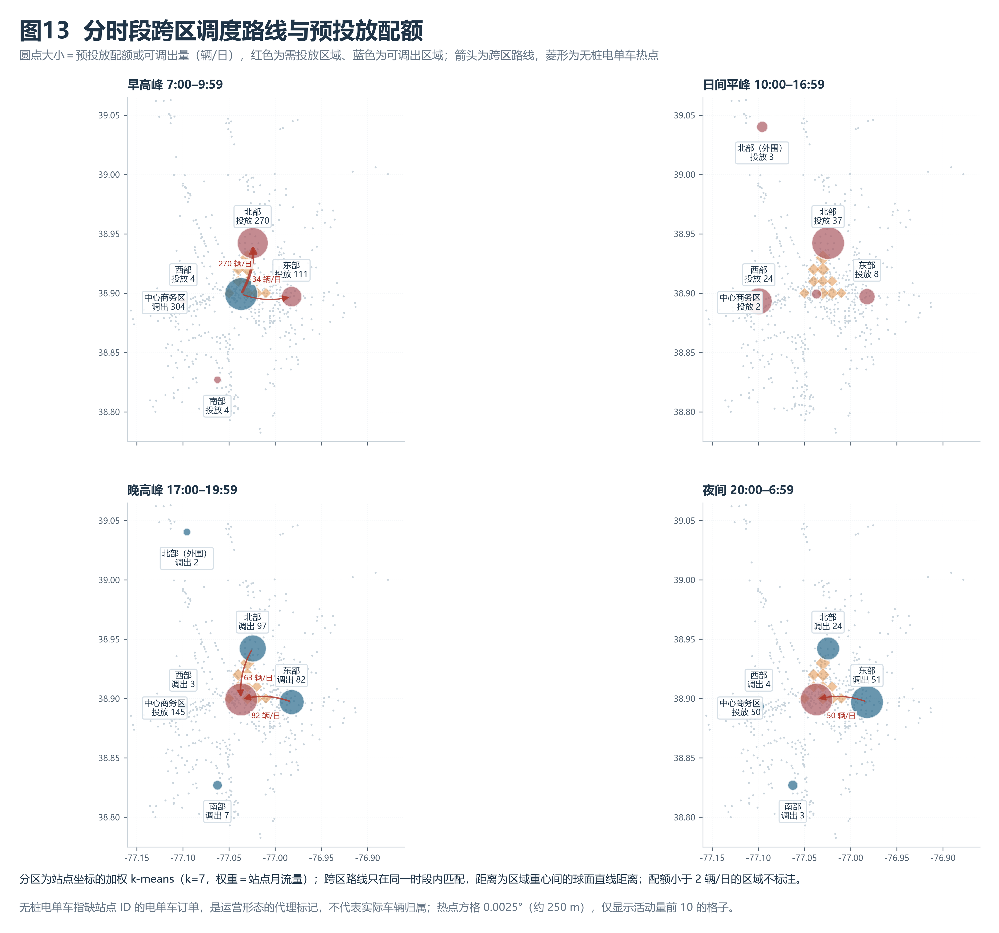
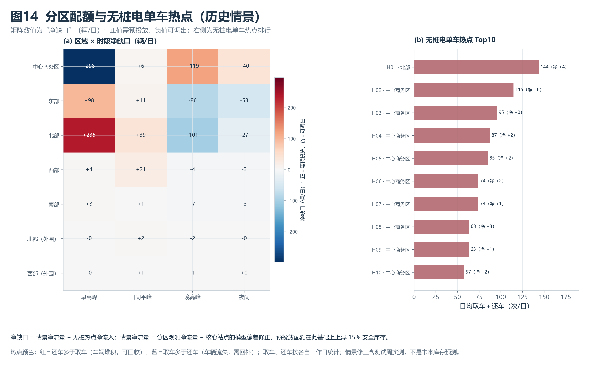

# 城市共享单车出行时空分析与调度优化

**本部分作者：康炜奕**

本部分包括站点空间分布、热门站点与高频 OD 走廊、站点潮汐失衡分析以及车辆调度策略测算，对应图9–图14。马文博负责数据清洗与基础探索，陈宇涵负责时间规律与需求预测；本部分使用马文博导出的站点子集，其他模块按各自问题选用全量有效集或站点子集。

样本以 1 月出发的行程为队列，保留其完整还车事件，包含跨月还车；因此以下事件统计并不等同于覆盖 1 月所有真实出发与还车的完整运营台账。逐小时曲线合并了多个工作日的同一小时，不能作为某个实际日期的库存轨迹。

## 7 站点空间分布与高频 OD 走廊

### 7.1 分析口径与样本

本部分使用站点有效集，即双端站点 ID 完整、骑行时长在 1–180 分钟（含边界）的记录，共 **180,914 条**，占全量有效集 233,180 条的 77.59%。站点归属以站点 ID 为准，名称按 ID 统一；同一 ID 的不同名称已在数据清洗阶段合并，因此本节不重复处理名称问题。

样本覆盖 **760 个站点**，其中 754 个曾作为起点、753 个曾作为终点，说明少数站点只出现在一侧。起终点相同的环线骑行 **4,611 次**，占站点子集的 2.55%；本节在统计站点总流量时保留环线，在统计 OD 走廊时将其剔除，剩余 **176,303 次**非环线骑行、**29,005 个**站点对。

站点 $i$ 的总出发量 $D_i$、总到达量 $A_i$ 按 1 月全月累计，净流量与失衡指数定义为：

```math
F_i = D_i - A_i, \qquad I_i = \frac{\left|F_i\right|}{D_i + A_i + 1}
```

$F_i>0$ 表示净流出，$F_i<0$ 表示净流入，可分别作为补车与取车压力的代理；没有库存和容量数据时不能确认实际缺车或满桩。分母加 1 是防零平滑项；加 1 后 $I_i$ 恒落在 $[0,1)$ 内，且对 $D_i+A_i$ 较大的站点影响较小。

### 7.2 站点总流量：头部集中，长尾很厚

**表7-1  总流量 Top5 站点（1 月累计）**

| 站点 | 总出发量 | 总到达量 | 总流量 | 净流量 | 失衡指数 |
| --- | ---: | ---: | ---: | ---: | ---: |
| Columbus Circle / Union Station | 2,845 | 2,786 | 5,631 | +59 | 0.010 |
| New Hampshire Ave & T St NW | 2,340 | 2,327 | 4,667 | +13 | 0.003 |
| 15th & P St NW | 1,921 | 1,908 | 3,829 | +13 | 0.003 |
| 14th & V St NW | 1,749 | 1,754 | 3,503 | −5 | 0.001 |
| Eastern Market Metro / Pennsylvania Ave & 8th St SE | 1,708 | 1,743 | 3,451 | −35 | 0.010 |

总流量最高的站点是联合车站（Columbus Circle / Union Station），全月 **5,631 次**，占站点总流量的 1.56%。Top10 站点合计 **36,845 次**，占 **10.18%**；站点总流量的中位数仅 146.5 次，第 90 百分位为 1,380 次，最少的站点全月只有 1 次。头部站点多位于交通枢纽、商业中心与高密度居住区，但整体分布呈明显的长尾结构：约一半站点的月流量不足 150 次。

### 7.3 高频 OD 走廊：联系高度分散，且以双向为主

**表7-2  双向合并后的高频 OD 走廊 Top5**

| 站点 A | 站点 B | A→B | B→A | 合计 | 主向占比 |
| --- | --- | ---: | ---: | ---: | ---: |
| Columbus Circle / Union Station | 8th & F St NE | 243 | 210 | 453 | 53.6% |
| 6th & H St NE | Columbus Circle / Union Station | 140 | 194 | 334 | 58.1% |
| Columbus Circle / Union Station | Maryland Ave & E St NE | 149 | 152 | 301 | 50.5% |
| Eastern Market Metro / Pennsylvania Ave & 8th St SE | Lincoln Park / 13th & East Capitol St NE | 153 | 112 | 265 | 57.7% |
| New Hampshire Ave & T St NW | 18th & New Hampshire Ave NW | 104 | 110 | 214 | 51.4% |

最强的走廊也只有 453 次，仅占非环线骑行的 0.26%；Top10、Top50、Top100 走廊分别占 **1.42%、4.22%、6.73%**。这说明本月站点间联系高度分散，不存在少数几条“主干走廊”承担大部分骑行；把调度资源集中在少量走廊上，收益会非常有限。29,005 个站点对中有 **14,515 个（50.04%）** 存在双向骑行，进一步说明多数联系是往返型的，而非单向。排名前 5 的走廊全部连接市中心枢纽（联合车站、东部市场）与东侧、北侧居住区，方向性上以“枢纽—居住区”的短途接驳为主。



**图9说明：**左图比较总流量最高的15个站点的出发与到达量，右图展示双向合并后骑行次数最多的15条 OD 走廊，对应前两节的站点与走廊统计。

### 7.4 空间分布：主城聚集，月度净流量普遍接近平衡


**图10说明：**气泡面积表示站点月总流量，颜色表示月净流量方向（红＝净流出，蓝＝净流入）。主城取景窗口内有 592 个站点，占骑行量的 **98.75%**；窗口外另有 168 个外围站点（合计 4,510 次，1.25%），为突出主城结构未绘出，但仍计入全部统计。颜色在净流量绝对值第 96 百分位（±84 辆）处截断，便于同时观察两端。

主城站点集中在华盛顿特区西北、市中心与东北三个组团，外围站点沿地铁线与郊区城镇稀疏分布，流量随距离快速衰减。值得强调的是：**月度尺度的净流量普遍接近平衡**，站点净流量的极值仅为 **+340 辆**（Adams Mill & Columbia Rd NW）与 **−243 辆**（8th & H St NW），绝对值超过 50 辆的站点只有 71 个。原因不是站点真的平衡，而是早高峰的净流出被晚高峰的净流入大量抵消。要观察真正的失衡，必须切到分时段口径，这正是第 8 节的内容。

## 8 站点潮汐失衡与车辆调度策略

### 8.1 早晚高峰的净流量与失衡指数

时段口径沿用组内约定：工作日指周一至周五（含 1 月 1 日与 1 月 15 日，与 `is_weekend` 的定义一致），全月共 **23 个**工作日；早高峰取 7:00–9:59、晚高峰取 17:00–19:59，各 3 个小时。

**到达量按还车时间归属。** 统计站点库存与调度需求时，一次 6:50 出发、7:10 还车的骑行应计入 7 时的到达，而不是 7 时的出发；若按出发小时汇总到达量，到达就变成同一批订单的镜像，无法表示该小时实际还车量。因此本节所有分时段统计中，出发量按 `started_at`、到达量按 `ended_at` 归属。站点月度总量（7.2–7.4 节）不区分时段，不受此口径影响。

时段 $t$ 内的净流量与失衡指数为：

```math
F_{i,t} = D_{i,t} - A_{i,t}, \qquad I_{i,t} = \frac{\left|F_{i,t}\right|}{D_{i,t} + A_{i,t} + 1}
```

$F>0$ 表示净流出（站点缺车），$F<0$ 表示净流入（站点积车）。分母加 1 是防零平滑项。

分级阈值取固定管理口径，而非按分位数自动划分：$|F|\ge 60$ 且 $I\ge 0.30$ 为严重失衡，$|F|\ge 30$ 且 $I\ge 0.20$ 为中度失衡，$|F|\ge 10$ 为轻度失衡，其余为基本均衡。同时约束净流量规模与失衡比例，可以避免“只有两三单、比例却很大”的低流量站点被误判为严重失衡。

**表8-1  早晚高峰失衡分级（按站点计）**

| 时段 | 出发量 | 到达量 | 有记录站点 | 缺车站点 | 积车站点 | 严重失衡 | 中度失衡 | 轻度失衡 | 基本均衡 |
| --- | ---: | ---: | ---: | ---: | ---: | ---: | ---: | ---: | ---: |
| 早高峰 | 28,779 | 28,281 | 674 | 383 | 259 | 156 | 66 | 144 | 308 |
| 晚高峰 | 37,690 | 39,084 | 699 | 254 | 407 | 44 | 73 | 197 | 385 |

缺车、积车按净流量符号统计（净流量为 0 的 32 个早高峰站点、38 个晚高峰站点未计入两侧），分级按上述阈值统计，两种划分口径不同，不能跨列相加；同一时段的四个分级列合计等于“有记录站点”。

由于出发与到达来自不同的订单集合，同一窗口内各站净流量之和不再为 0：早高峰为 **+498 辆**、晚高峰为 **−1,394 辆**。这个差额是跨越窗口边界的骑行（如 6:50 出发、7:10 还车），属于口径的正常结果，因此**不能**用“缺车合计 = 积车合计”来校验。早高峰缺车总量 **13,628 辆**、积车总量 **13,130 辆**；严重失衡站点 156 个，占早高峰有记录站点的 23.1%，说明潮汐失衡不是个别站点的问题，而是面上的结构性现象。

**表8-2  早高峰缺车与积车 Top3（1 月累计）**

| 方向 | 站点 | 出发量 | 到达量 | 净流量 $F$ | 失衡指数 $I$ |
| --- | --- | ---: | ---: | ---: | ---: |
| 缺车（净流出） | New Hampshire Ave & T St NW | 417 | 153 | +264 | 0.46 |
| 缺车（净流出） | 14th & V St NW | 368 | 105 | +263 | 0.55 |
| 缺车（净流出） | 17th & Corcoran St NW | 269 | 53 | +216 | 0.67 |
| 积车（净流入） | 17th & G St NW | 50 | 399 | −349 | 0.78 |
| 积车（净流入） | 17th & K St NW / Farragut Square | 99 | 429 | −330 | 0.62 |
| 积车（净流入） | 18th St & Pennsylvania Ave NW | 10 | 314 | −304 | 0.94 |

18th St & Pennsylvania Ave NW 的失衡指数高达 0.94，即每 100 次与该站相关的骑行中，出发与到达的差额接近 94 次，属于“几乎只进不出”的单向站点；17th & G St NW 的绝对量最大（−349 辆），单站每天的净积车约 15.2 辆（−349 ÷ 23）。

作为口径对照：若到达量也按出发小时统计（本节修订前的做法），早高峰缺车 Top3 为 +268、+260、+211，积车 Top3 为 −360、−335、−294，缺车合计 13,432 辆。修订后数值略有变化（缺车前两名互换），方向性结论不变；两套数字不应混用，本报告统一采用还车时间口径。

### 8.2 图11：早晚高峰方向整体反转


**图11说明：**每个面板上方为积车站点（净流入，向左），下方为缺车站点（净流出，向右），条尾数字为月累计净流量，括号内为失衡指数。出发量按出发时间、到达量按还车时间归属，因此每个面板内各站净流量之和不为 0。

早高峰与晚高峰的净流量方向整体相反：早高峰缺车 Top10 中有 **5 个**站点出现在晚高峰积车 Top10 中，早高峰积车 Top10 中则有 **8 个**站点出现在晚高峰缺车 Top10 中。New Hampshire Ave & T St NW 从早高峰 +264 变为晚高峰 −122，17th & G St NW 从 −349 变为 +213，14th & V St NW 从 +263 变为 −162。这种“上午出、晚上回”的形态是典型通勤潮汐，也意味着同一批站点在不同时段扮演完全相反的角色，调度方向必须随时段切换。

还需注意高峰强度的不对称：早高峰累计净流出压力 13,628 次，晚高峰仅 7,535 辆，前者是后者的 **1.81 倍**。早高峰的出行更集中、方向更一致，是调度压力的主要来源；晚高峰虽然出发次数更多（37,690 次），但到达更分散（39,084 次），单站点失衡反而更缓和。

### 8.3 图12：典型站点的 24 小时潮汐曲线


**图12说明：**上图为逐小时净流量（出发按出发时间、到达按还车时间），下图为以 0 时为起点的累计净流量；浅灰竖带为早晚高峰。代表站点的选取规则是：在早高峰且月流量不低于 800 次的站点中，分别取净流出最大（居住区代表）与净流入最大（商务区代表）者。

New Hampshire Ave & T St NW 代表居住区：早高峰出发 417 次、到达 153 次，净流出 +264（$I=0.46$）；累计净流量在 13 时达到峰值 **+264**，晚高峰 17–19 时净流入 −122，全天结束时收于 −6，基本回到零点。17th & G St NW 代表商务区：早高峰出发 50 次、到达 399 次，净流入 −349（$I=0.78$）；累计最低点 **−383** 出现在 10 时，晚高峰净流出 +213，回补到 −64 后结束。两条曲线的方向完全镜像，但幅度并不对等，商务区站点在工作日按小时汇总后累计净流入 64 辆，对应账面车辆增加的方向，不能解释为净丢车。

**关于符号：**图中的累计净流量先把全月多个工作日的同一小时合并，再沿 0–23 时累加，不能解读为某一天的库存轨迹。正值对应账面车辆减少方向，负值对应增加方向；居住区曲线在 13 时的 +264、商务区曲线在 10 时的 −383 都是此聚合口径下的流量。缺少期初库存、容量与运维记录，不能把它们当作某日需要补车或取车的数量。曲线仅提示值得进一步检查的时段：**净流出压力集中在 7–10 时，反向回流集中在 17–20 时**。

### 8.4 调度策略表与调运方案

在净流量与失衡指数的基础上，按以下规则生成历史候选配对：在同一高峰内，按净流出量从大到小依次处理前 30 个净流出目标站，每次从 6 km 内、仍有至少 1 辆/日供给余量的净流入站中取最近的站点，调运量取“目标需求”与“供给余量”的较小值，直到剩余需求小于 1 辆/日或没有可用供给；恰好 1 辆也参与匹配。月累计量按 23 个工作日折算为辆/日，匹配和汇总保留原始精度，仅在展示时舍入。线路表同时保存两端站点 ID，便于累计核对每个来源与目标的上限。

**表8-3  调运方案汇总**

| 时段 | 线路数 | 调运量（辆/日） | 覆盖缺车量 | 平均直线距离 | 最远距离 |
| --- | ---: | ---: | ---: | ---: | ---: |
| 早高峰 | 62 | 216.0 | 36.5% | 1.47 km | 3.76 km |
| 晚高峰 | 69 | 164.1 | 50.1% | 1.46 km | 3.45 km |
| 合计 | 131 | 380.2 | — | 1.46 km | 3.76 km |

各行与合计均由未舍入值独立格式化，所以显示值相加可能有 0.1 的尾差。

**表8-4  早高峰调运方案示例（按调运量排序）**

| 补车站点 | 取车站点 | 调运量（辆/日） | 直线距离 |
| --- | --- | ---: | ---: |
| 15th & W St NW | 15th & L St NW | 8.0 | 1.71 km |
| 17th & Corcoran St NW | 18th & M St NW | 7.8 | 0.83 km |
| Maryland Ave & E St NE | 14th St & New York Ave NW | 7.3 | 0.71 km |
| New Hampshire Ave & T St NW | Massachusetts Ave & Dupont Circle NW | 7.0 | 0.80 km |
| 13th & O St NW / Logan Circle | 15th & K St NW | 6.9 | 0.82 km |

方案的两个特征值得说明。第一，**匹配距离很短**：平均单程直线距离 1.46 km，最远 3.76 km，全部落在 6 km 上限内，说明净流入点与净流出点在空间上高度邻近，可以作为就近调运的候选配对。第二，**覆盖比例有限**：早高峰方案只覆盖净流出总量的 36.5%，因为方案只处理净流出最大的 30 个目标站（早高峰共有 383 个净流出站点），且供给受邻站余量约束；是否能执行仍需库存、车辆与人员数据验证。

该方案是按“最近邻优先”的贪心匹配得到的历史流量情景，尚未验证执行可行性；它没有考虑实时库存、车辆载重、装卸时间、人员班次、单行道与实际路网绕行。直线距离只是位置间的球面距离，真实行驶里程会更长。方案用于给出量级与空间配对关系，不能直接作为排班表使用。

### 8.5 结论与解释边界

在 1 月站点有效集与既定口径下，可以得到四点结论。其一，站点流量呈长尾分布，Top10 站点只占 10.18%，调度不能只盯头部站点。其二，站点间联系高度分散，Top10 走廊仅占非环线骑行 1.42%，说明站点联系较分散。其三，月度净流量普遍接近平衡，失衡主要发生在时段内部：早高峰累计净流出压力 13,628 次，是晚高峰的 1.81 倍，且方向与晚高峰相反。其四，按最近邻匹配的历史候选配对规模为 380 辆/日、131 条线路，平均距离 1.46 km，可在流量账面上覆盖早高峰 36.5%、晚高峰 50.1% 的净流出压力。

这些结论受以下条件限制。数据只有单月，无法判断季节性；没有实时库存、站点容量与车辆数，因此净流量只能作为“调度需求”的代理，不能确认实际缺车或满桩；订单流入流出不等于未满足的需求，缺车可能已经抑制了部分骑行；站点子集排除了 22.41% 缺站点的记录，这些记录以电单车为主，若其空间分布与站点骑行不同，结论会有偏差；工作日口径包含 1 月 1 日与 15 日两个节假日，可能轻微低估通勤峰值；到达量按还车时间归属后，窗口内缺车与积车不再配平（差额为边界流量），但站点级的方向判断不受影响；直线距离不能替代实际路程。数据支持检查早高峰潮汐失衡及邻近站点配对，但具体数值仅为该月、该口径下的估计，实际调运可行性仍需另外验证。

## 9 分时段跨区调度路线与预投放配额

### 9.1 数据、分区与情景边界

本节把 760 个站点按坐标与月流量权重划为 7 个片区。按早高峰 7:00–9:59、日间平峰 10:00–16:59、晚高峰 17:00–19:59、夜间 20:00–6:59 汇总，分母为 23 个工作日；这里的时段是历史数据分析窗口。

**这是回顾性情景测算。** 在站点整月日均净流量上，叠加陈宇涵冻结推荐模型在测试周（1 月 22–28 日）的“预测减实测”差额，再加入缺站点电单车的日均净流量。差额使用了测试周实测，事前不可获得；本节不参与预测模型的测试评分，也不能解释为预测起点之前可执行的未来调度方案。

预测子集由 `station_weekly_predictions.csv` 与 `station_model_selection.json` 自动导出到 `data/derived/core_station_predictions.csv`，保留原预测精度。陈宇涵按每个已知端点预测，空间模块使用双端站点完整队列，两者覆盖不同，因此此处只把 10 个核心站点的差额作为模型偏差敏感性修正，其余站点沿用历史流量，不能称为全城站点预测。

| 区域 | 站点数 | 月流量份额 | 区域重心 |
| --- | --- | --- | --- |
| 中心商务区 | 105 | 35.6% | 38.899, -77.037 |
| 东部 | 174 | 30.6% | 38.897, -76.982 |
| 北部 | 99 | 21.0% | 38.942, -77.024 |
| 西部 | 112 | 8.0% | 38.893, -77.099 |
| 南部 | 105 | 3.4% | 38.827, -77.063 |
| 北部（外围） | 75 | 0.8% | 39.040, -77.096 |
| 西部（外围） | 90 | 0.6% | 38.920, -77.287 |

### 9.2 缺站点电单车与还车时刻

无桩电单车沿用 `is_dockless_ebike` 代理标记，限定主城坐标窗口内出发的队列，共 51,604 条。主城窗口为纬度 38.79–39.00、经度 −77.13–−76.89；目的地随队列保留。借出按 `started_at`、归还按 `ended_at` 各自的工作日和时段统计，周日出发、周一还车的记录只计工作日归还，跨时段记录也不再错记为出发时段到达。队列按出发月份选取，缺少前一月出发订单，不能作为独立完整的运营事件台账。

热点按 0.0025° 网格的取还总活动量排序，保留前 15 格；其日均活动量合计 1090.7 次，净流入合计 +24.0 辆/日。配额计算使用全部入选队列的分区净流量，图中仅展示前 10 个热点，不能把前 15 格的净流入当作全区供给。

### 9.3 配额与供给约束

令 F 为站点日均净流出，Δ 为核心站点模型偏差修正，H 为缺站点电单车净流入（归还减借出）。情景缺口 G = F + Δ − H。正值只表示流出压力，不证明站点实际缺车。需求配额为 `ceil(max(G, 0) × 1.15)`，供给上限为 `floor(max(−G, 0))`：需求加入 15% 余量后向上取整，供给向下取整，避免把日均 1.1 辆当成可调出 2 辆。

**表 9-2 分时段情景配额（辆/日）**

| 时段 | 配额 | 可调出 | 已匹配调运 | 未覆盖 |
| --- | --- | --- | --- | --- |
| 早高峰 | 393 | 297 | 297 | 96 |
| 日间平峰 | 98 | 0 | 0 | 98 |
| 晚高峰 | 138 | 195 | 138 | 0 |
| 夜间 | 47 | 84 | 47 | 0 |

四个时段的配额合计 676 辆/日、可调出合计 576 辆/日，路线合计匹配 482 辆/日；这是各时段的流量求和，不能当作全日独立车辆数，同一辆车可能跨时段周转。

### 9.4 跨区候选路线

同一时段按最近邻匹配，并限制每个来源区域的累计调出量和每个目标区域的累计接收量。恰好 1 辆也参与匹配，没有供给或距离内没有来源时保留零覆盖结果。本次得到 6 条候选路线，区域重心间直线距离上限为 25 km。

| 时段 | 调出区域 | 投放区域 | 辆/日 | 直线距离 km | 目标覆盖率 |
| --- | --- | --- | --- | --- | --- |
| 夜间 | 东部 | 中心商务区 | 46 | 4.73 | 100.0% |
| 夜间 | 西部 | 西部（外围） | 1 | 16.49 | 100.0% |
| 早高峰 | 中心商务区 | 北部 | 271 | 4.90 | 100.0% |
| 早高峰 | 中心商务区 | 东部 | 26 | 4.73 | 23.0% |
| 晚高峰 | 东部 | 中心商务区 | 85 | 4.73 | 61.6% |
| 晚高峰 | 北部 | 中心商务区 | 53 | 4.90 | 38.4% |



**图13说明：**四个面板分别展示四个时段的区域角色、候选调度路线与热点位置；路线按区域重心之间的直线距离匹配。



**图14说明：**热力图展示区域与时段的情景缺口，热点排行展示格网取还活动。图13–14使用同一组配额和流量数据。

### 9.5 解释与局限

净流量不是库存；缺少期初存量、容量、人员、车辆与路网通行时间，不能证明可调出车辆实际存在，也不能把未覆盖配额直接称作必须新增投放的数量。分时段差额同时受途中车辆、队列边界、区域间流动与模型偏差影响，未逐项分解前不将其归因于单一因素。有效行程时长不超过 180 分钟，跨时段事件不能单独解释平峰的全部缺口。

缺站点标记不能确认运营形态，格网活动位置也不是可回收车辆的实时停放位置。区域划分权重和普通站点流量使用整月历史，核心修正使用测试周实测，两者只适合本节的历史敏感性情景。图13–14、配额表与路线表用于比较区域方向和规模；真正的事前方案需以当时可获得的信息重建输入，并加入实时库存与执行约束。

## 复核资料

本部分的图9–图14 同时提供 300 DPI PNG 与自包含 HTML（图片以 base64 内嵌，离线可打开）；正文数值与下列统计表、Notebook 对应，表中小数仅作展示性舍入。

- [图9 Top15 热门站点与高频 OD 走廊](../figures/fig09_top_stations_od.html)：PNG 版见 [fig09_top_stations_od.png](../figures/fig09_top_stations_od.png)。
- [图10 站点骑行热度空间分布](../figures/fig10_station_heatmap.html)：PNG 版见 [fig10_station_heatmap.png](../figures/fig10_station_heatmap.png)。
- [图11 早晚高峰净流量双向对比](../figures/fig11_peak_divergence.html)：PNG 版见 [fig11_peak_divergence.png](../figures/fig11_peak_divergence.png)。
- [图12 居住区与商务区 24 小时潮汐曲线](../figures/fig12_tidal_curves.html)：PNG 版见 [fig12_tidal_curves.png](../figures/fig12_tidal_curves.png)。
- [图13 分时段跨区调度路线](../figures/fig13_zone_dispatch_routes.html)：PNG 版见 [fig13_zone_dispatch_routes.png](../figures/fig13_zone_dispatch_routes.png)。
- [图14 分区预投放配额与无桩热点](../figures/fig14_zone_quota_hotspots.html)：PNG 版见 [fig14_zone_quota_hotspots.png](../figures/fig14_zone_quota_hotspots.png)。
- [站点流量汇总](../tables/station_flow_summary.csv)：760 个站点的出发、到达、净流量与失衡指数。
- [OD 走廊汇总](../tables/od_corridor_summary.csv)：29,005 个站点对的双向次数与主向占比。
- [高峰失衡汇总](../tables/peak_imbalance_summary.csv)：早晚高峰的净流量、失衡指数与分级。
- [逐小时净流量面板](../tables/hourly_net_flow.csv)：站点 × 小时的净流量，可用于重算潮汐曲线。
- [调运方案](../tables/dispatch_plan.csv)：131 条线路的目标站、取车站、站点 ID、调运量与距离。
- [区域划分](../tables/zone_profile.csv)：7 个片区的站点数、流量份额与重心。
- [分区预投放配额表](../tables/zone_preallocation_quota.csv)：区域 × 时段的观测/情景净流量、热点净流入、缺口、配额与覆盖情况。
- [跨区调度路线表](../tables/zone_dispatch_routes.csv)：6 条候选路线的调出/投放区域、调运量与距离。
- [无桩电单车热点](../tables/dockless_hotspots.csv)：热点方格坐标、取还车量与所属区域。
- [完整分析 Notebook](../../notebooks/03_spatial_and_dispatch.ipynb)：从站点汇总到图9–图14 与两张调度表的复现过程。

在项目根目录可依次运行 `python -m src.spatial_analysis`、`python -m src.imbalance_dispatch` 和 `python -m src.zone_dispatch` 重新生成图表与统计表；也可在项目环境的 Jupyter 中打开 Notebook，选择 `Python (Pyclass)` 内核后重启并运行全部单元格。陈宇涵的预测结果已整合到本仓库；核心预测子集由 `station_weekly_predictions.csv` 与冻结推荐记录自动导出（`data/derived/core_station_predictions.csv`）。依赖与环境配置见 [README](../../README.md)。
