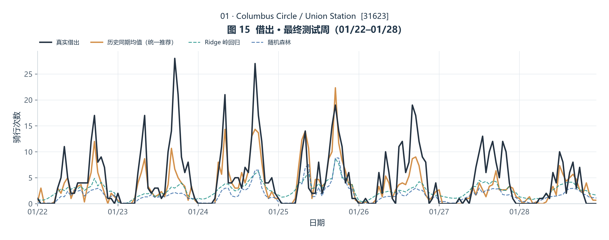

# 6.2 核心站点筛选与整周需求预测

**负责人：陈宇涵**

### 6.2.1 研究对象与数据选择

输入为全组统一的 `data/processed/clean_trips.csv`，共233,180条有效骑行。按目标分别保留已知端点：起点已知就产生借出事件，终点已知就产生归还事件；缺另一端不删除已经可归属的事件。

起终点都已知180,914条，仅起点已知16,781条，仅终点已知15,049条，两端都缺失20,436条。1月可归属借出197,695次、归还195,949次，另有14次归还发生在2月，不计入1月。

借出按start_station_id与started_at归属；归还按end_station_id与ended_at归属，不能使用属于出发时刻的hour/weekday代替归还时间。事件按自己的发生时间截断，已借出但尚未归还的订单只能进入此前借出统计。

有效骑行最长179.7667分钟，小于180分钟。缺少12月出发订单可能使1月1日00–02时的归还记录不完整，即使已有635次已观测归还，也不将其当作完整目标。这3小时归还和净流出记为缺失；其余已覆盖小时没有事件时计0。借出模型保留月初已知借出；站点筛选为统一借还口径，将最初3小时双方事件都排除。

这是固定清洗有效集中的历史事件预测，不能保证实时系统中数据已经全部到齐；未知端点未被补全。净流出是可归属观测流量的差，不等于库存变化、缺车数或未满足需求。

### 6.2.2 仅训练期筛选Top10并冻结

筛选只用1月1日03:00至1月15日00:00前的事件。候选门槛为（借出＋归还）÷14个日历日≥20次/日，且至少7个活动日。最初3小时不计入活动量，仍除14天，采用保守口径。共有220个站点满足条件。

分别求工作日、周末各小时的平均净流出（借出−归还），对24个小时逐项取绝对值后相加，再按10/14与4/14加权：

`潮汐分数 = (10/14) × Σ小时|工作日平均净流出| + (4/14) × Σ小时|周末平均净流出|`

单位为典型一天的时段流量差次数。先平均再取绝对值，强调反复出现的时段方向；不将全天净流出先相加，避免早出晚归相互抵消。普通工作日小时分母10天，最初三个小时仅9个完整工作日；周末每小时4天，未观察完整的小时不补0进入均值。

按分数降序选前10；并列先比较活动总量降序，再按站点ID文本升序。名称只取筛选期出现最多的名称，并列按名称文本排序，不用测试期选择显示名称。名单在1月15日之前冻结，最终测试不重新筛选。

| 排名 | 站点ID | 站点名称 | 潮汐分数 | 日均活动 | 活动天数 |
| --- | --- | --- | --- | --- | --- |
| 1 | 31623 | Columbus Circle / Union Station | 36.944 | 188.071 | 14 |
| 2 | 31101 | 14th & V St NW | 29.595 | 126.857 | 14 |
| 3 | 31229 | New Hampshire Ave & T St NW | 29.238 | 159.929 | 14 |
| 4 | 31233 | 17th & K St NW / Farragut Square | 27.952 | 61.786 | 14 |
| 5 | 31232 | 7th & F St NW / National Portrait Gallery | 25.738 | 75.857 | 14 |
| 6 | 31277 | 17th & G St NW | 25.659 | 47.929 | 14 |
| 7 | 31102 | 11th & Kenyon St NW | 23.587 | 66.429 | 14 |
| 8 | 31202 | 14th & R St NW | 23.460 | 99.857 | 14 |
| 9 | 31613 | Eastern Market Metro / Pennsylvania Ave & 8th St SE | 23.024 | 119.714 | 14 |
| 10 | 31640 | Maryland Ave & E St NE | 22.675 | 51.071 | 14 |

### 6.2.3 共享模型如何拟合，为什么适用

10站合并训练，但借出与归还分别拟合。原有16个特征为24/12小时正余弦、星期类别、周末及其小时交互、该站上周同小时需求；加入9个站点类别指示，共25个特征。站点ID不是连续数值。跨站共享时间规律，同时通过站点类别和本站历史需求表达站点差异。

共享模型减少分别为短序列拟合大量独立模型的需要；它也可能不完全贴合某站，因此保留逐站评估。跨站数据增加并没有增加独立历史周数，不能据样本行数声称充分验证。

| 方法 | 拟合与理由 | 优点和局限 |
|---|---|---|
| 历史同期均值 | 按站点、星期、小时平均截至预测前的完整观测 | 透明易复核；对周规模变化反应慢 |
| 上周同期 | 预测值直接等于该站上周对应小时 | 简单的补充对照；容易延续上周异常；只保留在完整评估文件 |
| Ridge | 标准化后拟合线性关系，优化平方误差＋α×系数平方和 | 系数受约束、复杂度可控；依赖给定特征表达 |
| 随机森林 | 自助抽样训练多棵受限决策树，取200棵树的平均 | 可表达非线性和交互；小量周历史仍可能过拟合、难预测突变 |

Ridge比较α=0.1/1/10/100；随机森林比较最大深度3/5、叶节点最少样本8/16，固定200棵树和随机种子42。两个学习模型使用相同特征；标准化只用训练行拟合。借还分别选择各家族的参数，统一方法家族可使用不同方向参数。

### 6.2.4 整周预测与统一推荐

| 阶段 | 使用历史 | 一次预测 | 借出学习行数 | 归还学习行数 |
|---|---|---|---:|---:|
| 验证 | 1月1–14日 | 1月15–21日，168小时 | 1680 | 1650 |
| 最终测试 | 1月1–21日 | 1月22–28日，168小时 | 3360 | 3330 |

周滞后消耗最初168小时；归还还需剔除由月初3个不完整小时引起的滞后缺失。目标周168小时的输入全部在周初已知。周内不回填实际需求；1月29–31日不参与选型或评价，不生成跨月预测。

验证先为借出、归还各自选择参数，再在历史均值、Ridge、随机森林中按以下分数统一推荐：

`统一分数 = (10站借出MAE平均 + 10站归还MAE平均) / 2`

并列先比对应两方向合并RMSE的平均，再按上述方法顺序。上周同期只作完整评估中的补充对照，不进入页面或正式推荐候选。推荐及参数在最终测试前冻结。最终测试仅检验，不回头调参或更改站点。

借出、归还的负预测各自截为0后，再相减形成预测净流出。净流出允许为负；原始预测亦保留。净流出误差可能因借还偏差抵消而较小，因此选型仍以借还平均MAE为主。

验证统一选定：**历史同期均值**。验证借还综合MAE为1.4207，最终测试为1.5134；最终测试逐站平均净流出MAE为1.6925。

**验证周统一推荐历史同期均值；两种学习模型没有在验证周获得更低的借还综合误差。** 推荐是针对10站整体的统一选择，不保证每个站点、每个目标都是单独最优。

10站测试周借出实际4,348次，预测2,968次，总量偏差-31.7%；归还实际4,349次，预测2,961次，偏差-31.9%。需要结合总量偏差判断效果，不能仅凭对照排名或较小的净流出误差认定高精度。

### 6.2.5 误差如何评价

MAE是每小时绝对误差的平均，越低越好；RMSE是平方误差平均后开平方，更重视大误差；R²用目标序列自身均值作误差参照，可能为负，不是准确率。站点目标完全不变时R²记为无定义，不填0。

逐站分别计算借出、归还、净流出的MAE/RMSE/R²与高峰MAE。总体主要看逐站MAE平均，不只看站点总量相加后的误差。高峰分别按预测前工作日/周末每小时均值最高两个小时确定；净流出按历史绝对净流出强度确定。日／周总量偏差为预测减真实；净流出总量可正可负、可能接近0，因此不报告其总量百分比误差。

最终测试整体指标如下，完整逐站指标见CSV：

| 方法 | 目标 | 逐站平均MAE | 合并RMSE | 逐站平均高峰MAE |
| --- | --- | --- | --- | --- |
| 历史同期均值 | 借出 | 1.527 | 2.517 | 3.133 |
| 历史同期均值 | 归还 | 1.500 | 2.545 | 3.695 |
| 历史同期均值 | 净流出 | 1.692 | 2.581 | 3.017 |
| 上周同期 | 借出 | 1.945 | 3.280 | 4.586 |
| 上周同期 | 归还 | 1.909 | 3.396 | 5.550 |
| 上周同期 | 净流出 | 1.877 | 2.974 | 4.121 |
| Ridge 岭回归 | 借出 | 1.760 | 2.969 | 4.396 |
| Ridge 岭回归 | 归还 | 1.826 | 3.219 | 5.662 |
| Ridge 岭回归 | 净流出 | 1.813 | 2.916 | 4.528 |
| 随机森林 | 借出 | 1.769 | 3.048 | 4.373 |
| 随机森林 | 归还 | 1.863 | 3.270 | 5.584 |
| 随机森林 | 净流出 | 1.796 | 2.871 | 4.388 |

### 6.2.6 展示与结论边界



HTML先解释筛选、模型与指标，再通过站点和目标选择器，每次展示一张最终测试周图。曲线为真实值、历史均值、Ridge、随机森林；验证图、日周总量、RF重要性折叠显示。默认站点按训练期潮汐排名选择，不按测试效果挑选。

图16只是借出与归还两个随机森林的内部重要性，按信息类型合并。类别或相关特征可能分摊权重，不能解释为因果，也不能证明模型有效。

只有一次验证周与一次最终测试周；样本仅为本次冻结Top10和可归属事件，不能推广成所有站点需求、真实库存或缺车量。没有天气、活动、容量等解释变量，不能确定需求波动原因。

### 6.2.7 工程与复现（不进入HTML）

```powershell
python -m src.station_model
python -B -m unittest discover -s tests -p test_station_model.py -v
```

独立生成reports/station_prediction.html；参数--input和--output-dir可指定输入和输出。本步骤不调用全城预测入口，不覆盖已验收成果。

- station_candidates.csv / station_top10.csv：候选活动量、潮汐分数、资格、排序与冻结名单。
- station_hourly_events.csv：10站×744小时，含借出、归还、净流出和归还完整性标记。
- station_weekly_predictions.csv：40,320行，2周×10站×168小时×4方法×3目标；含预测起点、历史来源、原始与最终预测。
- station_model_metrics.csv / station_overall_metrics.csv：逐站240行与总体24行。
- station_parameter_candidates.csv / station_method_scores.csv：20个参数候选及验证统一选型分数。
- station_daily_weekly_totals.csv：日周总量与偏差，净流出百分比不定义。
- station_feature_importance.csv / station_prediction_validation.csv：RF内部重要性与运行核验。
- station_model_selection.json：冻结名单、参数、输入、特征与来源说明。

CSV保留10位小数，HTML为阅读适当舍入。输入SHA-256：`1ea4c2d6ccc091e73f3633ec2f58b551fc9c3d1aec5e58f235995c426879d7c0`；站点代码SHA-256：`e12daf3433c7899d4283ec5751e1a4a21281b138bbe28664fb2a000d0123747e`；复用时间特征代码SHA-256：`394794ace3130ad560da46d86b30501d65b5aaa629711ce80844e6bd1cc7a223`。

选定参数：

```json
{
  "outflow": {
    "historical_mean": {},
    "last_week": {},
    "ridge": {
      "alpha": 100.0
    },
    "random_forest": {
      "n_estimators": 200,
      "max_depth": 5,
      "min_samples_leaf": 16,
      "random_state": 42,
      "n_jobs": 1
    }
  },
  "inflow": {
    "historical_mean": {},
    "last_week": {},
    "ridge": {
      "alpha": 100.0
    },
    "random_forest": {
      "n_estimators": 200,
      "max_depth": 5,
      "min_samples_leaf": 16,
      "random_state": 42,
      "n_jobs": 1
    }
  }
}
```

参考：[跨序列共享预测研究](https://arxiv.org/abs/2008.00444)、[Ridge](https://scikit-learn.org/stable/modules/generated/sklearn.linear_model.Ridge.html)、[随机森林](https://scikit-learn.org/stable/modules/generated/sklearn.ensemble.RandomForestRegressor.html)、[评价指标](https://scikit-learn.org/stable/modules/model_evaluation.html)。方法原理不替代本数据上的实测证据。
