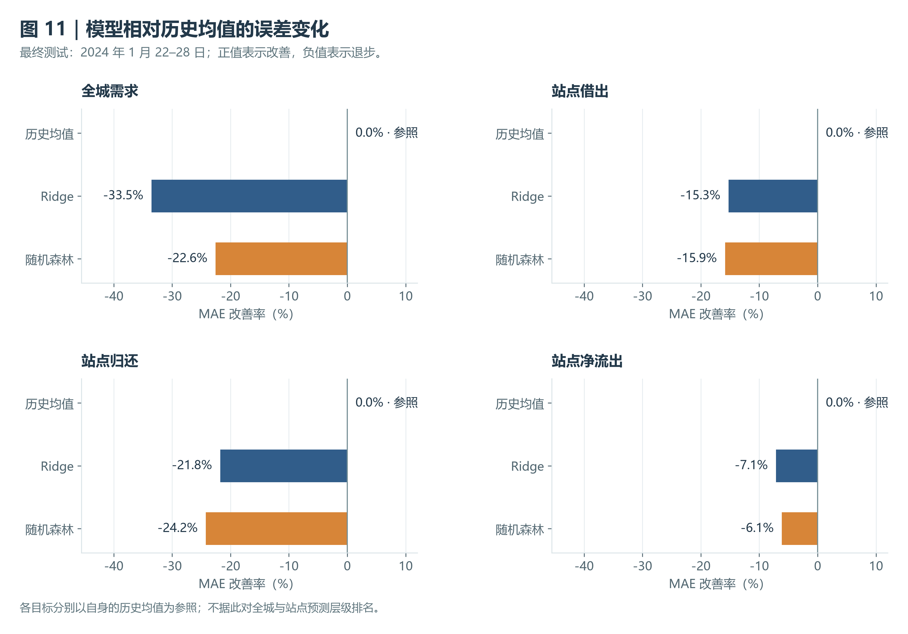
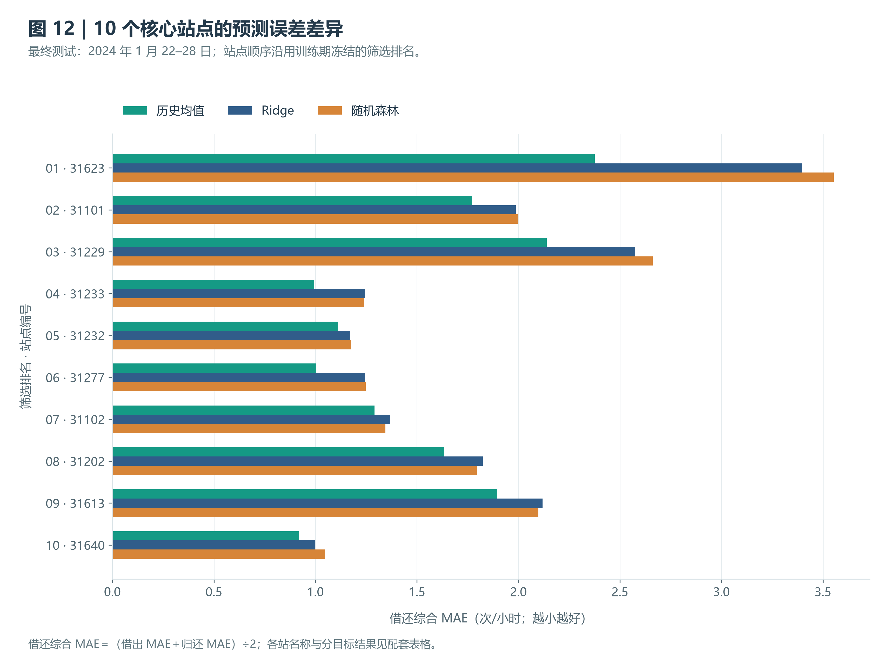

# 双层需求预测：综合比较、误差分析与结论汇总

本步骤汇总已验收的全城与核心站点预测，沿用原有预测、参数、Top 10 和推荐记录。第三步是模型对比与报告，不增加预测层级。

## 1. 方法、时间与评价口径

历史同期均值按相同星期和小时平均历史需求；Ridge 用系数约束控制线性模型复杂度；随机森林对多棵受限决策树的预测取平均。站点学习模型在 10 站间共享，借出与归还分别拟合，再相减得到净流出。方法的优点与适用理由见前两步说明，实际有效性以验证与测试为依据。

2024 年 1 月 1–14 日预测 15–21 日作验证；1–21 日预测 22–28 日作最终测试。每周一 00:00 一次预测 168 小时，周内不更新真实需求。1 月 29–31 日不参与本轮评价，不生成跨月预测。

MAE 为平均每小时绝对误差，RMSE 对大误差更敏感，R² 比较平方误差与目标序列均值参照，不是准确率。站点总体 MAE 是逐站 MAE 平均，RMSE 是所有站点小时误差合并计算；不把合并 RMSE 写成逐站 RMSE 平均，也不平均逐站 R²。全城与站点原始误差因规模、覆盖和目标不同而分开解读。

**MAE 改善率＝（历史均值 MAE－模型 MAE）÷历史均值 MAE ×100%。** 正值改善、负值退步；分母为零时无定义。该比例是描述性比较，不重新选型。

## 2. 总体比较

图 11 各面板分别以本目标的历史均值为零基准，不用于跨层级判优。以下完整指标保留上周同期作为补充对照；HTML 只展示另外三种方法。站点总体 R² 留空，逐站值见 CSV。

### 最终测试周

| 对象 | 方法 | MAE | RMSE | 高峰MAE | R² | MAE改善率 |
| --- | --- | --- | --- | --- | --- | --- |
| 全城需求 | 历史同期均值 | 144.149 | 234.921 | 330.643 | 0.510 | +0.0% |
| 全城需求 | 上周同期（补充） | 237.673 | 346.750 | 577.286 | -0.068 | -64.9% |
| 全城需求 | Ridge 岭回归 | 192.488 | 291.891 | 543.957 | 0.243 | -33.5% |
| 全城需求 | 随机森林 | 176.664 | 276.378 | 509.045 | 0.321 | -22.6% |
| 站点借出 | 历史同期均值 | 1.527 | 2.517 | 3.133 | — | +0.0% |
| 站点归还 | 历史同期均值 | 1.500 | 2.545 | 3.695 | — | +0.0% |
| 站点净流出 | 历史同期均值 | 1.692 | 2.581 | 3.017 | — | +0.0% |
| 站点借出 | 上周同期（补充） | 1.945 | 3.280 | 4.586 | — | -27.4% |
| 站点归还 | 上周同期（补充） | 1.909 | 3.396 | 5.550 | — | -27.3% |
| 站点净流出 | 上周同期（补充） | 1.877 | 2.974 | 4.121 | — | -10.9% |
| 站点借出 | Ridge 岭回归 | 1.760 | 2.969 | 4.396 | — | -15.3% |
| 站点归还 | Ridge 岭回归 | 1.826 | 3.219 | 5.662 | — | -21.8% |
| 站点净流出 | Ridge 岭回归 | 1.813 | 2.916 | 4.528 | — | -7.1% |
| 站点借出 | 随机森林 | 1.769 | 3.048 | 4.373 | — | -15.9% |
| 站点归还 | 随机森林 | 1.863 | 3.270 | 5.584 | — | -24.2% |
| 站点净流出 | 随机森林 | 1.796 | 2.871 | 4.388 | — | -6.1% |

### 验证周

| 对象 | 方法 | MAE | RMSE | 高峰MAE | R² | MAE改善率 |
| --- | --- | --- | --- | --- | --- | --- |
| 全城需求 | 历史同期均值 | 156.619 | 215.450 | 395.464 | -1.223 | +0.0% |
| 全城需求 | 上周同期（补充） | 199.655 | 283.703 | 519.143 | -2.854 | -27.5% |
| 全城需求 | Ridge 岭回归 | 209.431 | 250.326 | 309.925 | -2.000 | -33.7% |
| 全城需求 | 随机森林 | 205.191 | 253.867 | 315.534 | -2.086 | -31.0% |
| 站点借出 | 历史同期均值 | 1.433 | 2.333 | 3.832 | — | +0.0% |
| 站点归还 | 历史同期均值 | 1.409 | 2.421 | 4.418 | — | +0.0% |
| 站点净流出 | 历史同期均值 | 1.497 | 2.327 | 3.761 | — | +0.0% |
| 站点借出 | 上周同期（补充） | 1.704 | 2.935 | 4.707 | — | -18.9% |
| 站点归还 | 上周同期（补充） | 1.669 | 2.982 | 5.400 | — | -18.5% |
| 站点净流出 | 上周同期（补充） | 1.787 | 2.864 | 4.500 | — | -19.3% |
| 站点借出 | Ridge 岭回归 | 1.680 | 2.311 | 3.208 | — | -17.3% |
| 站点归还 | Ridge 岭回归 | 1.794 | 2.555 | 3.999 | — | -27.3% |
| 站点净流出 | Ridge 岭回归 | 1.243 | 1.890 | 2.599 | — | +17.0% |
| 站点借出 | 随机森林 | 1.671 | 2.330 | 3.567 | — | -16.7% |
| 站点归还 | 随机森林 | 1.694 | 2.433 | 4.244 | — | -20.3% |
| 站点净流出 | 随机森林 | 1.239 | 1.974 | 2.775 | — | +17.2% |

## 3. 推荐依据与有效性

两层验证均选中历史同期均值。全城按验证 MAE 选方法；站点在历史均值、Ridge、随机森林中，以借出与归还逐站平均 MAE 再取平均统一推荐。测试后的结果用于检验，不替换推荐。

最终测试历史均值全城 MAE 为 144.15 次/小时；站点借还综合 MAE 为 1.5134 次/站·小时，净流出 MAE 为 1.6925。学习模型在本次整体比较中没有超过历史均值。

验证周随机森林的净流出 MAE 虽较低，净流出并不是统一选型指标。借还预测相减可能抵消误差，因此它不能单独证明借还预测准确，也不应据此更改统一推荐。

## 4. 总量、高峰与逐日偏差

| 最终测试对象 | 实际总量 | 预测总量 | 预测－实际 | 偏差率 |
| --- | --- | --- | --- | --- |
| 全城需求 | 67,307 | 45,307.3 | -21,999.7 | -32.7% |
| 站点借出 | 4,348 | 2,968.0 | -1,380.0 | -31.7% |
| 站点归还 | 4,349 | 2,961.0 | -1,388.0 | -31.9% |
| 站点净流出 | -1 | 7.0 | +8.0 | 不使用百分比 |

历史均值测试周全城低估 32.7%，10 站借出低估 31.7%、归还低估 31.9%。推荐方法仍有明显规模偏差，不能仅因对照排名较好就称为高精度。

全城历史均值在测试周 7 天均低估；01 月 26 日与 01 月 27 日合计占整周总量缺口的 63.2%。这定位了偏差集中的日期，但不能确定波动原因。

高峰掩码直接使用原预测文件的 is_peak；原口径为预测前训练期工作日/周末每小时均值最高两个小时，净流出按绝对强度。逐站及总体高峰 MAE 沿用此定义，未根据目标周重新挑选。

| 对象 | 每日绝对总量偏差最大日期 | 实际次数 | 预测次数 | 偏差次数 |
| --- | --- | --- | --- | --- |
| 全城需求 | 2024-01-27 | 12,318 | 5,342.0 | -6,976.0 |
| 站点借出 | 2024-01-26 | 830 | 428.0 | -402.0 |
| 站点归还 | 2024-01-27 | 750 | 327.7 | -422.3 |
| 站点净流出 | 2024-01-27 | -32 | 2.7 | +34.7 |

上表按每日加总后的偏差绝对值排序，仅描述每日总量问题，不等于小时误差最大的一天。完整日周数据见 model_comparison_daily_bias.csv；净流出可能为负或接近零，偏差率统一不定义。

## 5. 逐站差异与特征解释

图 12 中各站综合 MAE＝（借出 MAE＋归还 MAE）÷2，按训练期潮汐排名显示。单站单目标的最优方法可能不同，但不改变验证时的统一推荐。逐站 MAE、RMSE、R²、高峰 MAE、总量偏差，以及综合 MAE 见 model_comparison_station.csv。综合目标没有约定的 RMSE 或 R²，留空而不混算。

按借还综合 MAE 比较，本次 10/10 个站点的历史同期均值不差于两种学习模型。这一结论针对综合误差，单个目标仍需分别检查。

| 排名 | 站点编号 | 站点名称 | 历史均值综合MAE | Ridge综合MAE | 随机森林综合MAE |
| --- | --- | --- | --- | --- | --- |
| 1 | 31623 | Columbus Circle / Union Station | 2.376 | 3.397 | 3.553 |
| 2 | 31101 | 14th & V St NW | 1.771 | 1.987 | 2.000 |
| 3 | 31229 | New Hampshire Ave & T St NW | 2.139 | 2.575 | 2.661 |
| 4 | 31233 | 17th & K St NW / Farragut Square | 0.994 | 1.244 | 1.239 |
| 5 | 31232 | 7th & F St NW / National Portrait Gallery | 1.109 | 1.171 | 1.176 |
| 6 | 31277 | 17th & G St NW | 1.005 | 1.245 | 1.247 |
| 7 | 31102 | 11th & Kenyon St NW | 1.291 | 1.370 | 1.345 |
| 8 | 31202 | 14th & R St NW | 1.633 | 1.825 | 1.795 |
| 9 | 31613 | Eastern Market Metro / Pennsylvania Ave & 8th St SE | 1.895 | 2.119 | 2.098 |
| 10 | 31640 | Maryland Ave & E St NE | 0.921 | 0.998 | 1.047 |

| 随机森林模型 | 信息类型 | 内部重要性 |
| --- | --- | --- |
| 全城随机森林 | 小时周期 | 68.9% |
| 全城随机森林 | 上周同小时需求 | 26.9% |
| 全城随机森林 | 星期类别 | 3.2% |
| 全城随机森林 | 周末与小时的交互 | 1.0% |
| 全城随机森林 | 周末标记 | 0.1% |
| 借出随机森林 | 该站上周同小时需求 | 57.8% |
| 借出随机森林 | 小时周期 | 22.1% |
| 借出随机森林 | 星期类别 | 12.1% |
| 借出随机森林 | 站点类别 | 6.0% |
| 借出随机森林 | 周末与小时的交互 | 1.9% |
| 借出随机森林 | 周末标记 | 0.1% |
| 归还随机森林 | 该站上周同小时需求 | 69.7% |
| 归还随机森林 | 小时周期 | 17.7% |
| 归还随机森林 | 星期类别 | 8.4% |
| 归还随机森林 | 站点类别 | 2.9% |
| 归还随机森林 | 周末与小时的交互 | 1.3% |
| 归还随机森林 | 周末标记 | 0.0% |

重要性为已有随机森林内部权重，相关或类别特征可能分摊权重。它不解释历史均值推荐方法，不代表因果，不构成有效性证明。

## 6. 结论与适用范围

历史同期均值是本次验证选中的统一方法，最终测试的整体比较也支持优先采用这一简单对照。当前 Ridge 和随机森林设置没有带来整体改善证据；这不等于模型在其他数据和设置下均无效。

本次只有一个月、一次验证周和一次测试周。共享站点模型增加站点行数，没有增加独立历史周数。结果限于冻结 Top 10 和可归属事件，预测的是清洗后的已观测订单而非全部潜在需求。净流出不能直接解释为库存变化、缺车数量或未满足需求。

没有天气、节假日活动、库存、容量等解释变量，不能确定周规模波动的原因。后续宜先积累更多连续周，在多个预测起点评价稳定性，再检验预测时可获得的外部信息；新增方法应另用验证安排评价。

## 7. 运行与核验记录（不进入 HTML）

独立入口：`python -m src.model_comparison`。可用 `--source-reports` 指向包含原有 tables 的报告目录，`--output-dir` 指定第三步输出报告目录。只读取已有产物，不导入或调用模型训练入口。

新增四份 CSV、两张 PNG、HTML、本 MD，以及 model_comparison_checks.json。图像为 300 DPI，HTML 内嵌图片与 CSV，可单独离线使用；前两步详情跳转需相邻保留对应 HTML。运行同一输入会更新第三步同名产物。

源文件指纹、逐项一致性检查与元信息保存在 tables/model_comparison_checks.json。工程检查记录另附交付说明。

前两步详情：[全城说明](03_city_demand_prediction.md)、[站点说明](04_station_demand_prediction.md)。
